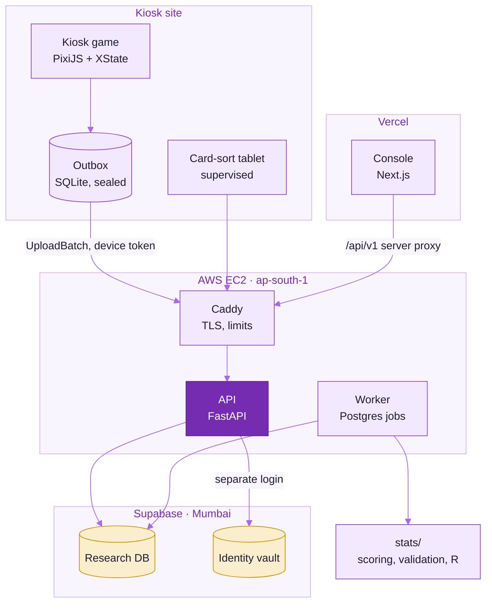
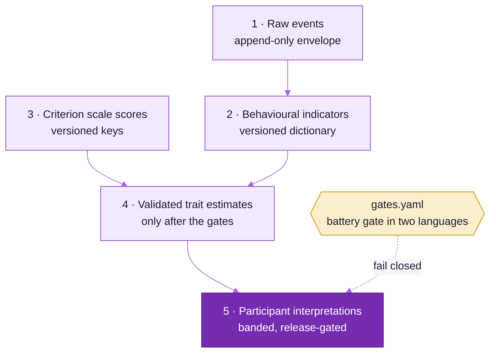
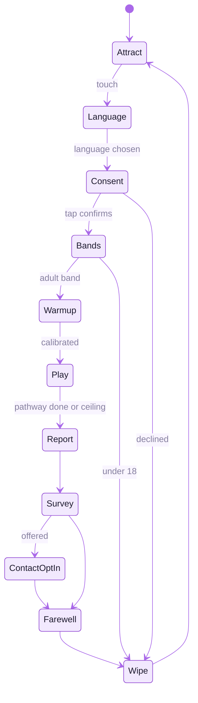

<picture>
  <source media="(prefers-color-scheme: dark)" srcset="docs/readme-kit/assets/hero-dark.svg">
  
</picture>

<p align="center">
  <picture>
    <source media="(prefers-color-scheme: dark)" srcset="https://readme-typing-svg.demolab.com?font=Plus+Jakarta+Sans&weight=600&size=20&duration=2800&pause=900&color=C090F5&center=true&vCenter=true&width=760&lines=A+measurement+instrument+first%2C+a+game+second;Touch+always+works%2C+voice+is+optional;Thresholds+live+in+YAML%2C+never+in+code;Reports+stay+off+until+the+gates+pass">
    
  </picture>
</p>

<p align="center">
  
  
  
  
  <a href="https://github.com/cxacraftecosystem-ui/behavioural-games/actions/workflows/ci.yml"></a>
</p>

SHRIII Kiosk Behavioural Games is a research-grade behavioural assessment system for public kiosks in India.
Short, touch-first, voice-optional games at a golden-hour village market fair record how people play, and that
behaviour becomes **candidate indicators** for 17 constructs. Every indicator is validated against a standard
psychometric criterion battery before anything is reported to a player, and until then reports fail closed.

> Treat the system as a scientific measurement instrument first and a game second.

<picture>
  <source media="(prefers-color-scheme: dark)" srcset="docs/readme-kit/assets/stats-dark.svg">
  
</picture>

<picture>
  <source media="(prefers-color-scheme: dark)" srcset="docs/readme-kit/assets/divider-dark.svg">
  
</picture>

## &nbsp; What it does

<picture>
  <source media="(prefers-color-scheme: dark)" srcset="docs/readme-kit/assets/cards-dark.svg">
  
</picture>

| Surface | Who uses it | Where it lives |
|---|---|---|
| Kiosk game: attract, language, spoken consent, picture bands, warm-up, Pathway A or B, report, survey, farewell | Players aged 18+ | `frontend/packages/kiosk-game`, shells in `frontend/apps/kiosk` (Vite) and `frontend/apps/kiosk-electron` |
| Research console: studies, participants, instruments and administration, imports, analytics, traits, models, validation workbench, reports | Researchers, administrators, analysts | `frontend/apps/web` at `/research/*` |
| Admin console: kiosks and signed remote commands, users and grants, content and ITC sign-off, audio takes, game drafts, retention and legal holds, policy signing | Administrators | `frontend/apps/web` at `/admin/*` |
| Criterion card sort on a tablet (supervised sites only) | Trained administrators | `frontend/apps/card-sort-app` (Capacitor 8) |
| API and job worker: ingestion, consent, linkage, studies, devices, gates, release packs, erasure | Kiosks and the consoles | `backend/api` |
| Scoring, validation, simulation, R psychometrics, reports, pre-registration | The measurement team | `stats/` |

### Pathway B: the micro-game carousel

<picture>
  <source media="(prefers-color-scheme: dark)" srcset="docs/readme-kit/assets/cards-games-dark.svg">
  
</picture>

Pathway A is three linked story episodes, **The Stall**, **The Weighing Post** and **The Road Home**, with an
optional supervised co-play episode outside the 15-minute budget. Every module declares indicators for at least
two constructs, and `uv run pytest content` recomputes each module's budget against the session cap.

<picture>
  <source media="(prefers-color-scheme: dark)" srcset="docs/readme-kit/assets/divider-dark.svg">
  
</picture>

## &nbsp; How it works

<picture>
  <source media="(prefers-color-scheme: dark)" srcset="docs/readme-kit/assets/pipeline-dark.svg">
  
</picture>



The five data layers never mix. Each one reads only the layer below it plus its own versioned rules:



| Layer | Contract | Rules from |
|---|---|---|
| 1. Raw events | `contracts/schemas/event-envelope.v1.schema.json`, `upload-batch.v1` | `contracts/` |
| 2. Behavioural indicators | `scoring-dictionary-*.v1.schema.json` | `stats/measurement-model/dictionary/*.yaml` |
| 3. Criterion scale scores | `instrument.v1.schema.json` | `content/instruments/*.yaml` |
| 4. Validated trait estimates | `gates.v1.schema.json` | `stats/measurement-model/gates.yaml`, `hypotheses.yaml` |
| 5. Participant interpretations | `ReleasePack`, `ReportArtefact` | `gates.yaml` report rules, `content/i18n/lines.yaml` |

A kiosk session is one statechart (`frontend/packages/kiosk-game/src/session/session-machine.ts`). Every step
has a ceiling, the whole session has a 900 s cap, and every exit wipes the screen back to attract:



<picture>
  <source media="(prefers-color-scheme: dark)" srcset="docs/readme-kit/assets/divider-dark.svg">
  
</picture>

## &nbsp; Live pilot

**<https://behavioural-games.vercel.app>** runs the console against the production pilot backend. The database
holds **synthetic studies only** ("SYNTHETIC DEMO ..." and "SYNTHETIC SMOKE TEST"); no participant data has
been collected.

| Route | What it is |
|---|---|
| `/` | Landing page linking the three areas |
| `/login` | Staff sign-in with email or username and password; accounts come from an administrator and the first sign-in asks for a new password. Google sign-in is built and appears once a client id is configured |
| `/research`, `/admin` | The role- and study-scoped consoles, served by the API through a server-side proxy, so the browser only talks to the Vercel origin |
| `/kiosk` | The kiosk game as a public demonstration. It never uploads: the public site is not a registered kiosk |

| Piece | Where | State on 4 Nov 2026 |
|---|---|---|
| Console | Vercel project `behavioural-games` | `main` deploys production, except pushes that change only docs; previews use the in-app demo API and never reach production |
| API, worker, Caddy | EC2 `t3.small`, `ap-south-1`, 2 GiB swapfile | image `1c2c87c`; api 206 MiB of a 700 MiB cap, worker 143 of 600, caddy 13 of 128 |
| Research DB and identity vault | Supabase Pro, Mumbai, PostgreSQL 17 | research migration `0008`, identity `i0002`; `/readyz` reports both databases ok |

Deployment, operations and secrets: [`docs/deploy/aws-ec2.md`](docs/deploy/aws-ec2.md) and
[`docs/deploy/supabase.md`](docs/deploy/supabase.md).

<picture>
  <source media="(prefers-color-scheme: dark)" srcset="docs/readme-kit/assets/divider-dark.svg">
  
</picture>

## &nbsp; Built with

<p align="center">
  <picture>
    <source media="(prefers-color-scheme: dark)" srcset="https://skillicons.dev/icons?i=ts,react,vite,nextjs,tailwind,electron,py,fastapi,postgres,r,docker,aws,supabase,vercel,githubactions&theme=dark&perline=15">
    
  </picture>
</p>

| Layer | Stack |
|---|---|
| Kiosk | React 19, PixiJS 8, GSAP 3, XState 5, Vite 8; Electron 44 with a `node:sqlite` outbox and per-session HPKE sealing; ESC/POS printing; sherpa-onnx keyword spotting (opt-in) |
| Console | Next.js 16, Tailwind 4, ECharts 6, the island nav and tokens of the field-repo frontend rules |
| Backend | FastAPI, Pydantic 2, SQLAlchemy 2, Alembic, psycopg 3; a Postgres job queue (`FOR UPDATE SKIP LOCKED`) |
| Science | numpy, scipy, statsmodels, pingouin, semopy, scikit-learn; R `shriiipsy` (lavaan, mirt, lordif, lme4, cNORM, GAMLSS) |
| Contracts | JSON Schema 2020-12 with generated TypeScript and Ajv validators, and generated Pydantic models |
| Toolchain | Node 24, pnpm 12, Turborepo, Biome 2.5, TypeScript 7; Python 3.14 with uv, ruff and mypy |

<picture>
  <source media="(prefers-color-scheme: dark)" srcset="docs/readme-kit/assets/divider-dark.svg">
  
</picture>

## &nbsp; Quick start

You need Node 24 and pnpm 12 (`corepack enable`), Python 3.13+ with [uv](https://docs.astral.sh/uv/) (CI and the
images use 3.14; `uv python pin 3.14` matches them), and PostgreSQL 18 for the API and the database suites.

1. Install both workspaces.

   ```bash
   pnpm install                 # frontend/* and contracts
   uv sync --all-packages       # backend, stats, contracts/python, tools
   ```

2. Play the game. No database needed.

   ```bash
   pnpm --filter @shriii/kiosk dev   # http://localhost:5173, ?module=<id> opens one module
   ```

3. Run the API, worker and consoles.

   ```bash
   cp infra/compose/.env.example .env && cp infra/compose/.env.example infra/compose/.env
   pnpm db:up                                              # PostgreSQL 18 in Docker
   uv run shriii-api migrate && uv run shriii-api seed --demo
   uv run shriii-api serve                                 # :8000
   uv run shriii-api worker
   pnpm --filter web dev                                   # http://localhost:3000
   ```

| Task | Command |
|---|---|
| Synthetic sessions to scoring to validation | `uv run shriii-api demo-pipeline --fast` |
| Full-session bot | build with `VITE_E2E_BRIDGE=true`, `vite preview`, then `node frontend/apps/kiosk/e2e/full-session.mjs --url <preview url> --pathway A` |
| Build (fails on contract drift) | `pnpm build` |
| JS checks | `pnpm lint && pnpm -r typecheck && pnpm test` |
| Python checks | `uv run ruff check . && uv run ruff format --check . && uv run mypy && uv run pytest` |
| Regenerate contracts | `pnpm contracts:generate` and `uv run python contracts/python/src/shriii_contracts/codegen.py` |

Kiosk dev switches (`frontend/apps/kiosk/.env`, never honoured by production builds): `VITE_DEV_VOICE_PLACEHOLDER=true`
for a Web Speech placeholder with a "DEV VOICE" banner, and `VITE_DEV_OVERLAY=true` for the seed, trial and
frame-timing overlay.

<details>
<summary><b>Contracts and scientific content workflows</b></summary>

**Contracts.** Edit a schema in `contracts/schemas/` (restricted 2020-12 profile: no `if/then/else`,
`unevaluated*` or `$dynamicRef`; every `oneOf` needs a `discriminator`). Minor versions add optional fields only;
a breaking change needs a new major file and an upcaster. Run both generators, adjust `contracts/fixtures/`, then
`pnpm test` and `uv run pytest`: both sides validate the same fixtures (strict writers, tolerant readers).

**Science.** The dictionary, hypotheses and gates are **v0 drafts**. Freezes happen through signed governance
records (PLT-09), and after a freeze a threshold changes only by amendment. `uv run pytest stats/measurement-model`
checks schema validity, the 17-construct count, matrix rules and cross-references. Instrument YAML never holds
copyrighted item wording: item text loads at administration time from the licensed source in `item_text_source`.
Game configs carry budget estimates that `uv run pytest content` recomputes against the plan's session budget.

</details>

<details>
<summary><b>Repository layout</b></summary>

```text
frontend/   apps/kiosk (Vite shell), apps/kiosk-electron (Electron runtime), apps/web (Next.js console),
            apps/card-sort-app (Capacitor tablet), packages/kiosk-game, outbox-sqlite, session-crypto,
            escpos-printer, asr-sherpa
backend/    api/: FastAPI service, job worker, PostgreSQL schema and Alembic migrations
stats/      measurement-model/ (dictionary, hypotheses, gates YAML), scoring/, validation/, simulator/,
            rbridge/, r-psychometrics/ (R), reports/, prereg/
contracts/  JSON Schemas, generated TS types and validators, fixtures; python/ (Pydantic models)
content/    game configs, criterion instruments, voice-line catalogue and translations
infra/      compose/, docker/, ec2/ (production host), supabase/, kiosk-image/ (Ubuntu Core), pki/ (step-ca), tofu/
cicd/       CI gates and helper scripts called by .github/workflows
tools/      audio-pipeline, asr-bakeoff, i18n, loadtest, provision, replay, timing-calibration
docs/       plan, decisions, architecture, status, deploy, governance, security, science, readme-kit
config/     tsconfig.base.json
```

The root holds only files a tool requires there; [`docs/ARCHITECTURE.md`](docs/ARCHITECTURE.md#the-repository-root)
says why each one must be at the root.

</details>

<picture>
  <source media="(prefers-color-scheme: dark)" srcset="docs/readme-kit/assets/divider-dark.svg">
  
</picture>

## &nbsp; Documentation

| Question | Read |
|---|---|
| What is built, what is validated, what is missing? | [`docs/STATUS.md`](docs/STATUS.md) |
| What is the science, feature by feature (`ENG-07`, `SCR-01`, ...)? | [`docs/IMPLEMENTATION_PLAN.md`](docs/IMPLEMENTATION_PLAN.md) |
| Which decisions bind this build? | [`docs/BUILD_DECISIONS.md`](docs/BUILD_DECISIONS.md) |
| How is the repository laid out, and how does each part run? | [`docs/ARCHITECTURE.md`](docs/ARCHITECTURE.md) |
| What product shape (routes, DB domains, dashboards) does the spec ask for? | [`docs/reference/agent-implementation-spec.md`](docs/reference/agent-implementation-spec.md) |
| How is production deployed, operated and rotated? | [`docs/deploy/aws-ec2.md`](docs/deploy/aws-ec2.md), [`docs/deploy/supabase.md`](docs/deploy/supabase.md) |
| What are the threats, controls and open findings? | [`docs/security/`](docs/security/README.md) |
| What do the DPIA, consent scripts and IEC protocol say? | [`docs/governance/`](docs/governance/README.md) |
| What changed in the measurement model since the plan? | [`docs/science/`](docs/science/indicator-review.md) |
| Which CI gate checks what? | [`cicd/README.md`](cicd/README.md) |
| How are these README visuals made? | [`docs/readme-kit/README_STYLE.md`](docs/readme-kit/README_STYLE.md) |

<picture>
  <source media="(prefers-color-scheme: dark)" srcset="docs/readme-kit/assets/divider-dark.svg">
  
</picture>

## &nbsp; Status

<picture>
  <source media="(prefers-color-scheme: dark)" srcset="docs/readme-kit/assets/timeline-dark.svg">
  
</picture>

Both pathways play end to end and every scoring job runs, but **nothing is validated on people yet**: every
indicator, composite and trait estimate is research-only, and player reports stay behind the release gate. The
open gaps are timing on real kiosk hardware, native-speaker recordings, native review of the hi-IN, mr-IN and
ta-IN drafts, and ingestion latency against the ING-02 target. The full list is in
[`docs/STATUS.md`](docs/STATUS.md#known-gaps).

CI runs on every pull request: lint, types, unit and property tests, database suites on PostgreSQL 18 with migrations also proven on 17,
full-session bot playthroughs of both pathways through kiosk, API and scoring, Playwright with axe in light and
dark, Electron, R, CodeQL and OSV-Scanner. Nightly runs add the simulated VAL-02 study, the load-test suite and
the measurement-science checks. Dependabot opens grouped weekly updates after a 7-day soak.

<picture>
  <source media="(prefers-color-scheme: dark)" srcset="docs/readme-kit/assets/footer-dark.svg">
  
</picture>
