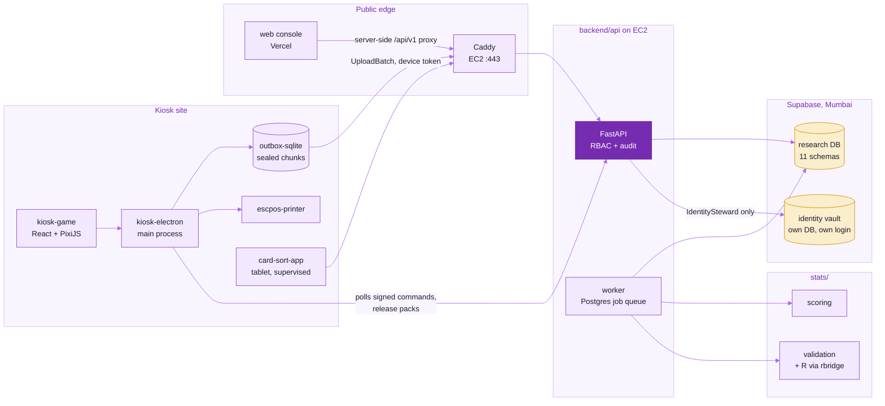
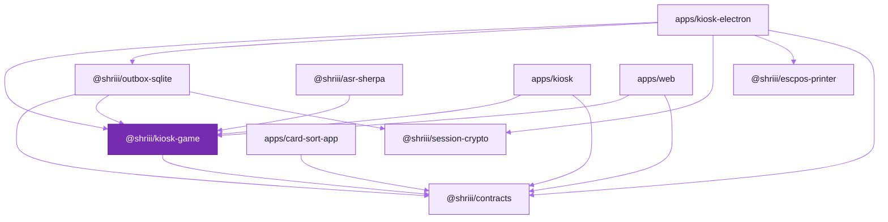
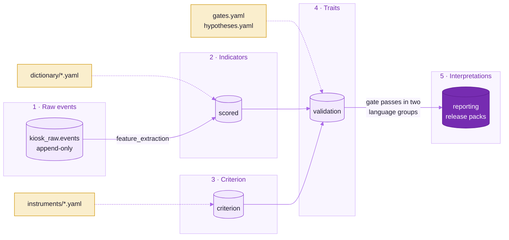

<picture>
  <source media="(prefers-color-scheme: dark)" srcset="readme-kit/assets/pipeline-dark.svg">
  
</picture>

# Repository architecture

The repository is grouped by responsibility: one directory for the player and researcher front ends, one for
the backend service, one for statistical modelling, one for the shared contracts, and so on. Package names
did not change in the October 2026 reorganisation (`@shriii/kiosk-game`, `@shriii/contracts`, `shriii_api`,
`shriii_scoring`, ...); only directories moved.

## The system



The same `kiosk-game` library is mounted three ways: by the Vite kiosk shell (`frontend/apps/kiosk`, the
offline build), by the Electron runtime that wraps it on a real kiosk, and by the web console at `/kiosk` as a
public demonstration that never uploads.



## Layout

```
.
├─ frontend/                     Everything that renders in a browser or on the kiosk (pnpm workspace)
│  ├─ apps/
│  │  ├─ kiosk/                  @shriii/kiosk: Vite + React kiosk shell (offline build; electron/ scaffold)
│  │  ├─ kiosk-electron/         @shriii/kiosk-electron: hardened Electron runtime (outbox, crypto, printer IPC,
│  │  │                          device token, signed remote commands)
│  │  ├─ web/                    web: Next.js console, /kiosk, /research/*, /admin/* (deployed on Vercel)
│  │  └─ card-sort-app/          @shriii/card-sort-app: Capacitor tablet app for the criterion card sort
│  └─ packages/
│     ├─ kiosk-game/             @shriii/kiosk-game: React + PixiJS game library (engine, onboarding, games, report)
│     ├─ outbox-sqlite/          @shriii/outbox-sqlite: durable kiosk outbox on node:sqlite
│     ├─ session-crypto/         @shriii/session-crypto: per-session HPKE sealing (+ python/ reference decryptor)
│     ├─ escpos-printer/         @shriii/escpos-printer: ESC/POS receipt rendering
│     └─ asr-sherpa/             @shriii/asr-sherpa: on-device keyword spotting adapter (sherpa-onnx)
├─ backend/
│  └─ api/                       shriii-api: FastAPI service, job worker, PostgreSQL 18 schema + Alembic migrations
├─ stats/                        Statistical modelling (Python uv members + R)
│  ├─ measurement-model/         dictionary/*.yaml, hypotheses.yaml, gates.yaml (+ tests): the frozen science inputs
│  ├─ scoring/                   shriii-scoring: layer 2 indicator engine, layer 3 criterion scoring
│  ├─ validation/                shriii-validation: reliability, validity, structure, fairness, prediction, norming
│  ├─ simulator/                 shriii-simulator: synthetic players with known traits (parameter recovery)
│  ├─ rbridge/                   shriii-rbridge: Python bridge to the R backend
│  ├─ r-psychometrics/           shriiipsy R package (lavaan, mirt, lordif, lme4, cNORM, GAMLSS) + testthat
│  ├─ reports/                   shriii-reports: stage reports and technical manual templates
│  └─ prereg/                    shriii-prereg: OSF-style pre-registration generator
├─ contracts/                    @shriii/contracts: canonical JSON Schema 2020-12, generated TS types and Ajv
│  │                             validators, shared fixtures, codegen scripts
│  └─ python/                    shriii-contracts: Pydantic v2 models generated from the same schemas
├─ content/                      games/*.json, instruments/*.yaml, i18n/ (voice-line catalogue, translations), tests
├─ infra/
│  ├─ compose/                   docker-compose.yml (dev Postgres + Adminer), compose.full.yml (whole stack),
│  │                             .env.example, env/, postgres-init/
│  ├─ docker/                    api / web / kiosk / r-psychometrics Dockerfiles, nginx config, healthcheck
│  ├─ ec2/                       production host: provisioning, user data, Caddyfile, compose, deploy, secrets
│  ├─ supabase/                  bootstrap_roles.py (login and NOLOGIN roles, SSM URLs)
│  ├─ kiosk-image/               Ubuntu Core 24 image, gadget and the shriii-kiosk snap
│  ├─ pki/                       step-ca for kiosk mTLS identities
│  └─ tofu/                      OpenTofu: bootstrap, platform, modules, envs (not used by the pilot)
├─ cicd/                         CI gates and helper scripts called by .github/workflows (see cicd/README.md)
│  ├─ plan-lint/  trial-budget/  scripts/  e2e/
├─ tools/                        Developer tools that are not part of a pipeline gate
│  ├─ audio-pipeline/  asr-bakeoff/  i18n/  loadtest/  provision/  replay/  timing-calibration/
├─ docs/                         IMPLEMENTATION_PLAN.md, BUILD_DECISIONS.md, ARCHITECTURE.md (this file),
│                                STATUS.md, deploy/, reference/, governance/, security/, science/,
│                                screenshots/, readme-kit/ (README visual system)
├─ config/                       tsconfig.base.json (extended by every package tsconfig)
└─ .github/                      workflows/ (must stay here), codeql/, dependabot.yml
```

## The repository root

The root holds only files that a tool insists on finding there:

| File | Why it must be at the root |
|---|---|
| `package.json` | pnpm workspace root; also carries the Node pin (`engines.node`, read by `actions/setup-node` via `node-version-file: package.json`) and the pnpm pin (`packageManager`, read by corepack and `pnpm/action-setup`) |
| `pnpm-workspace.yaml`, `pnpm-lock.yaml` | pnpm only looks for them next to the workspace root |
| `turbo.json` | Turborepo requires the root config |
| `biome.json` | Biome 2.5 discovers its config by walking up for `biome.json`/`biome.jsonc`/`.biome.json(c)` only (no `.config/` lookup). `frontend/apps/web/biome.json` extends it with `"extends": "//"`, and the per-package `biome check .` scripts and editor plugins rely on that discovery, so `--config-path` from `config/` is not a workable substitute |
| `pyproject.toml`, `uv.lock` | uv workspace root; also holds the ruff, mypy and pytest settings and the Python floor (`requires-python`) |
| `.gitignore`, `.gitattributes` | git reads them from the root (`.gitattributes` enforces LF endings) |
| `README.md` | Rendered by GitHub |
| `.github/` | GitHub Actions, CodeQL and Dependabot only read it there |

Everything else lives below the root:

- `config/tsconfig.base.json`: the shared compiler options. Every package `tsconfig.json` extends it by
  relative path, and `turbo.json` lists it under `globalDependencies`.
- Version pins: Node in `package.json` `engines`, pnpm in `packageManager`, Python as `requires-python`
  (floor 3.13) plus `PYTHON_VERSION: "3.14"` in the workflows and `ARG PYTHON_VERSION=3.14` in the API image.
  There is no `.nvmrc` or `.python-version`. Developers who want uv to use exactly 3.14 locally run
  `uv python pin 3.14`; the file it writes is gitignored.
- `.editorconfig` was dropped. Formatting is enforced by tools rather than editor hints: Biome formats
  JS/TS/JSON/CSS (2-space, LF, width 100), `ruff format` formats Python (4-space, width 120), and
  `.gitattributes` normalises line endings for every text file.
- Tool caches go to one gitignored `.cache/` directory: `.cache/ruff` (`[tool.ruff] cache-dir`),
  `.cache/mypy` (`[tool.mypy] cache_dir`), `.cache/pytest` (`[tool.pytest.ini_options] cache_dir`),
  `.cache/hypothesis` (`HYPOTHESIS_STORAGE_DIRECTORY`, set in the Hypothesis suites' `conftest.py`) and
  `.cache/turbo` (`turbo.json` `cacheDir`; CI caches the same path). Vitest already keeps its cache under each
  package's `node_modules/.vite`. `.venv/` and `node_modules/` stay in their standard locations.
- `.claude/` (agent worktrees under `.claude/worktrees/`) is gitignored and excluded from Biome, ruff, mypy
  and pytest collection.

## What each top-level directory owns

| Directory | Owns | Does not own |
|---|---|---|
| `frontend/` | Rendering, input, timing, the kiosk outbox and on-device crypto; the researcher/admin UI | Scientific thresholds (read from YAML via generated code), persistence beyond the outbox |
| `backend/` | Ingestion, consent, linkage, studies, devices, gates and release packs, report tokens, erasure, the job worker and the database schema | Indicator formulas and psychometrics (called through adapters into `stats/`) |
| `stats/` | Every number that is a scientific claim: indicator definitions, hypotheses, gate rules, scoring, validation, simulation, R analyses, reports and the pre-registration | Transport and storage |
| `contracts/` | The wire and file formats shared by all of the above, in both languages | Business logic |
| `content/` | Game configs, criterion instruments and voice lines | Code |
| `infra/` | Container images, local and full-stack compose, the production host (`ec2/`), Supabase roles, the kiosk OS image and PKI, OpenTofu | Application code |
| `cicd/` | Pipeline logic that can run on a laptop | Workflow YAML (in `.github/workflows`) |
| `tools/` | One-off and maintenance tooling (audio, ASR bake-off, translation round trips, load testing, kiosk provisioning, session replay, timing calibration) | CI gates |

`stats/` is deliberately not called `statistics/`: that name shadows the standard-library `statistics`
module when pytest imports test files by path (`--import-mode=importlib`), which breaks seaborn and
pingouin.

## The five data layers

| Layer | Contract | Produced by | Rules from |
|---|---|---|---|
| 1. Raw events (append-only) | `contracts/schemas/event-envelope.v1.schema.json`, `upload-batch.v1` | `frontend/packages/kiosk-game` logger, `frontend/packages/outbox-sqlite`, ingested by `backend/api` | `contracts/` |
| 2. Behavioural indicators | `contracts/schemas/scoring-dictionary-*.v1.schema.json` | `stats/scoring` (called by the `backend/api` worker) | `stats/measurement-model/dictionary/*.yaml` |
| 3. Criterion scale scores | `contracts/schemas/instrument.v1.schema.json` | `stats/scoring` criterion keys, stored by `backend/api` | `content/instruments/*.yaml` |
| 4. Validated trait estimates | `contracts/schemas/gates.v1.schema.json`, validation results | `stats/validation`, `stats/r-psychometrics` via `stats/rbridge` | `stats/measurement-model/gates.yaml`, `hypotheses.yaml` |
| 5. Participant interpretations | `ReleasePack`, `ReportArtefact` schemas | `backend/api` release packs, rendered by `frontend/packages/kiosk-game` (report) | `stats/measurement-model/gates.yaml` report rules, `content/i18n/lines.yaml` |

Layers are never mixed: each one reads only the layer below it plus its versioned rules.



## How to run each part

Install once from the repository root:

```bash
pnpm install                     # frontend/* and contracts (pnpm workspace)
uv sync --all-packages           # backend/api, stats/*, contracts/python, tools/i18n, tools/loadtest (uv workspace)
```

| Part | Command (from the root) |
|---|---|
| Kiosk dev server | `pnpm --filter @shriii/kiosk dev` (http://localhost:5173) |
| Web app | `pnpm --filter web dev` (http://localhost:3000) |
| Electron runtime | `pnpm --filter @shriii/kiosk-electron electron:install` once, then `pnpm --filter @shriii/kiosk-electron build && pnpm --filter @shriii/kiosk-electron start` |
| Game art gallery | `pnpm --filter @shriii/kiosk-game gallery` |
| Database | `pnpm db:up` (`docker compose -f infra/compose/docker-compose.yml up -d postgres`) |
| API | `uv run shriii-api migrate && uv run shriii-api seed --demo && uv run shriii-api serve --reload` |
| Worker | `uv run shriii-api worker` |
| Whole stack in containers | `docker compose -f infra/compose/compose.full.yml up --build` |
| Card-sort tablet app | `pnpm --filter @shriii/card-sort-app dev` (see `frontend/apps/card-sort-app/README.md`) |
| Production host | `infra/ec2/deploy.sh` over SSM Run Command ([deploy/aws-ec2.md](deploy/aws-ec2.md)) |
| Contracts codegen | `pnpm contracts:generate` and `uv run python contracts/python/src/shriii_contracts/codegen.py` |
| Scoring / validation / simulator tests | `uv run pytest stats/scoring/tests stats/validation/tests stats/simulator/tests` |
| Measurement-model checks | `uv run pytest stats/measurement-model/tests` |
| R psychometrics | `docker build -f infra/docker/r-psychometrics.Dockerfile -t shriii/r-psychometrics stats/r-psychometrics` (see `stats/r-psychometrics/README.md`) |
| Pre-registration | `uv run shriii-prereg --help` |
| Reports | `uv run shriii-reports --help` |
| CI gates | see [`cicd/README.md`](../cicd/README.md) |
| All JS checks | `pnpm lint && pnpm -r typecheck && pnpm -r test` |
| All Python checks | `uv run ruff check . && uv run ruff format --check . && uv run mypy && uv run pytest` |

API tests and the load-test integration tests need PostgreSQL; without it they skip (set
`SHRIII_REQUIRE_DB=1` to make a missing database fail instead).

Docker Compose reads `infra/compose/.env`; the API and Python tooling read `.env` in the directory they are
started from (normally the root). `infra/compose/.env.example` documents both.

## Old to new path map

| Before | Now |
|---|---|
| `apps/kiosk` | `frontend/apps/kiosk` |
| `apps/kiosk-electron` | `frontend/apps/kiosk-electron` |
| `apps/web` | `frontend/apps/web` |
| `apps/api` | `backend/api` |
| `packages/kiosk-game`, `outbox-sqlite`, `session-crypto`, `escpos-printer`, `asr-sherpa` | `frontend/packages/<same name>` |
| `packages/contracts` | `contracts` |
| `python/shriii_contracts` | `contracts/python` |
| `python/shriii_scoring` | `stats/scoring` |
| `python/shriii_validation` | `stats/validation` |
| `python/shriii_simulator` | `stats/simulator` |
| `python/shriii_rbridge` | `stats/rbridge` |
| `r/psychometrics` | `stats/r-psychometrics` |
| `scoring/` | `stats/measurement-model/` |
| `reports/` | `stats/reports/` |
| `tools/prereg` | `stats/prereg` |
| `tools/plan-lint` | `cicd/plan-lint` |
| `tools/trial-budget` | `cicd/trial-budget` |
| `.github/scripts` | `cicd/scripts` |
| `.github/e2e/smoke.py` | `cicd/e2e/smoke.py` |
| `docker-compose.yml`, `.env.example` | `infra/compose/docker-compose.yml`, `infra/compose/.env.example` |
| `renovate.json` | removed (Dependabot: `.github/dependabot.yml`) |
| `tools/loadtest/results/**` | removed (CI artifact `loadtest-<run id>`; earlier runs remain in git history) |

Unchanged: `content/`, `docs/`, `infra/docker`, `infra/tofu`, `infra/compose/compose.full.yml`,
`tools/audio-pipeline`, `tools/asr-bakeoff`, `tools/i18n`, `tools/loadtest`.

Added after the reorganisation: `frontend/apps/card-sort-app`, `infra/ec2`, `infra/supabase`,
`infra/kiosk-image`, `infra/pki`, `tools/provision`, `tools/replay`, `tools/timing-calibration`, `docs/deploy`,
`docs/science` and `docs/readme-kit`.
