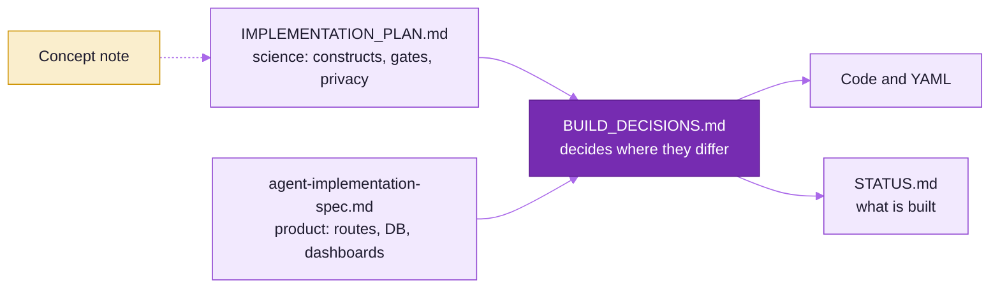

# Build Decisions — Iteration 1 (reconciling the plan and the agent spec)

Date: 2026-10-21. Inputs:
- `docs/IMPLEMENTATION_PLAN.md` — 145-feature research plan (the **scientific source of truth**: constructs, indicators, gates, validation rules, privacy rules).
- `docs/reference/agent-implementation-spec.md` — user-supplied spec (the **product/engineering shape**: unified web app routes, DB domains, API groups, dashboards, five data layers, definition of done).
- `docs/reference/Kiosk_Behavioural_Games_Concept_Note.pdf` — the concept note.

Where the two disagree, this file decides. Everything not mentioned here follows the plan; product surface (routes, tables, APIs, dashboards) follows the spec.



## Non-negotiables (both documents agree)
1. **Five distinct data layers**, never mixed: (1) raw events (append-only) → (2) behavioural indicators (versioned scoring dictionary) → (3) psychometric criterion scores (versioned keys) → (4) validated trait estimates (only after gates) → (5) participant-facing interpretations (banded, strengths-framed, release-gated).
2. Touch is always sufficient; voice is optional, closed-vocabulary, and always mirrored by an icon. No keyboard, no reading required on the kiosk.
3. Narrative/instructions are **pre-recorded** by native speakers in production. No runtime TTS in production builds.
4. No visible scores during play. No numbers, no negative labels in player reports. Reports disabled until the battery gate passes in ≥2 language groups (fail closed).
5. Camera / facial / voice-tone are **not** trait signals and are not implemented.
6. Private-dice integrity is **group-level only**; never classify an individual as dishonest.
7. Adults only (18+) by default; consent by tap, separate archive and contact opt-ins; no audio retained.
8. Scientific thresholds live in YAML (`stats/measurement-model/dictionary/*.yaml`, `stats/measurement-model/hypotheses.yaml`, `stats/measurement-model/gates.yaml`), never hard-coded.
9. Every derived score references algorithm version, source records and data snapshot; everything is reproducible from raw events.

## Decisions for this build iteration

| Topic | Plan said | Spec said | **Decision (iteration 1)** | Why |
|---|---|---|---|---|
| App structure | Separate Electron kiosk + ODK + Metabase | One unified Next.js app with `/kiosk`, `/research/*`, `/admin/*` | **Monorepo.** `frontend/packages/kiosk-game` (React + PixiJS game library) is mounted both by `frontend/apps/kiosk` (Vite; the Electron-ready, offline kiosk build) **and** by `frontend/apps/web` at `/kiosk` (Next.js). `frontend/apps/web` hosts all `/research/*` and `/admin/*` routes from the spec. | Satisfies the spec's unified routes while keeping the timing-critical, offline kiosk build the plan requires. |
| Kiosk shell / OS | Electron on Ubuntu Core 24 | — | **Browser-first build now**, with `frontend/apps/kiosk/electron` scaffold (main/preload, kiosk mode). Ubuntu Core image deferred to field-readiness. | Lets the game run and be tested on any machine today. |
| Offline outbox | SQLite in Electron main | Local buffering | **IndexedDB (Dexie) outbox** in the browser build behind an `Outbox` interface; SQLite adapter later for Electron. Gapless per-session `seq`, idempotent batch upload by `batch_id`, `event_id` dedup server-side. | Same contract, portable storage. |
| Game rendering | PixiJS 8 | Phaser + GSAP | **PixiJS 8 + GSAP + pixi-filters**, XState 5 for session/trial statecharts. | Pixi gives full control of art direction and timing; GSAP for cinematic transitions. |
| Art & sound | (assets TBD) | Illustrative images only | **Original procedural/vector art** (hand-authored SVG + Pixi Graphics, lighting via filters, particles, parallax) for a golden-hour Indian village market fair; **procedural Web Audio** music & SFX (drone, percussion, ambience). No third-party images. | No licensed assets exist yet; avoids IP risk; looks premium. |
| Voice-over | Pre-recorded only | Pre-recorded only | Audio **manifest system** keyed by line ID × language, loudness-normalised Opus slots. Until recordings exist, a **dev-only** placeholder (`VITE_DEV_VOICE_PLACEHOLDER`, Web Speech synthesis, banner "DEV VOICE") is allowed and is **compiled out of production builds**. | Keeps the rule; unblocks testing. |
| ASR | sherpa-onnx after bake-off (P1) | Constrained ASR | `SpeechInput` interface; touch always works. Dev adapter (Web Speech, off by default); sherpa-onnx keyword-spotting adapter is a later feature. | Voice is optional by design. |
| Backend | FastAPI | FastAPI + Pydantic | **FastAPI + Pydantic v2 + SQLAlchemy 2 + Alembic + psycopg 3**, PostgreSQL 18 via Docker Compose. | Agreed. |
| Jobs | Dagster | Celery/Redis | **Postgres-backed job table + worker (`FOR UPDATE SKIP LOCKED`)**, idempotent, retryable, input-hashed. Dagster is the documented upgrade path. | No extra infra; spec requires idempotent/observable/retryable jobs only. |
| Psychometrics | Python + R (lavaan, semTools, mirt) | Python (SciPy, statsmodels, semopy) + ML | **Python now** (numpy, scipy, statsmodels, pingouin, semopy, factor_analyzer, scikit-learn, xgboost). R is not installed on the dev machine; an `RBackend` adapter boundary is defined for invariance/IRT-DIF/norming (lavaan/semTools/mirt/cNORM) and implemented later. Python covers: split-half (permutation, Spearman–Brown), ICC(A,1)/(C,1) with CIs, alpha/omega, MTMM, disattenuation, EFA + parallel analysis, CFA (semopy), logistic-regression DIF, multi-group comparisons, equivalence tests (TOST), grouped-CV incremental validity. All checked against reference values. | Works on this machine; keeps the door open for R. |
| Criterion capture | ODK Central + Collect | In-app researcher-administered mode + CSV/XLSX import | **In-app administration** in `frontend/apps/web` (`/research/instruments/.../administer`, tablet layout, audio-assist slots) **plus** CSV/XLSX import with column mapping (covers ODK exports). | Spec requirement; ODK stays importable. |
| Instrument item text | — | Licensing metadata | Registry stores structure, scoring keys, reverse items, subscales, licensing metadata. **Copyrighted item wording is not committed**; items carry IDs + placeholder text to be loaded from a licensed source file. | IP compliance. |
| Auth | Cognito + step-ca | OIDC + RBAC | **OIDC-ready auth with RBAC** (roles: admin, researcher, administrator, analyst, kiosk device). Dev mode uses a local signed-JWT dev login. | Provider-agnostic. |
| Research dashboards | Metabase + Quarto | Custom React dashboards (ECharts/Plotly) | **Custom dashboards in `frontend/apps/web`** (ECharts), incl. the Trait Validation Workbench. Exports CSV/Parquet. | Spec requirement. |
| Hosting | AWS ap-south-1 | Docker, IaC | Docker Compose for dev/pilot; IaC deferred. | Keep it simple. |
| Languages | hi-IN, mr-IN, ta-IN placeholders | — | Same + `en-IN` for development. | — |

## Where the decisions stand (2026-11-04)

The table above records iteration 1 as decided. Later work kept every non-negotiable and moved these decisions on:

| Topic | Iteration 1 | Now |
|---|---|---|
| Kiosk shell / OS | Browser-first, Electron scaffold, Ubuntu Core deferred | `frontend/apps/kiosk-electron` is the hardened runtime (sandbox, context isolation, CSP, deny-all permissions, device token, signed remote commands). The Ubuntu Core 24 image and `shriii-kiosk` snap build in CI (`kiosk-image.yml`); no fleet has run them |
| Offline outbox | IndexedDB (Dexie), SQLite later | `@shriii/outbox-sqlite` on `node:sqlite` in Electron, events sealed per session with `@shriii/session-crypto` (HPKE to the backend X25519 key). The browser build keeps Dexie and is never used with participants |
| ASR | Web Speech dev adapter; sherpa-onnx later | `@shriii/asr-sherpa` keyword-spotting adapter built, opt-in, not field-tested; touch still always works |
| Psychometrics | Python now, R later behind `RBackend` | Both: the R package `shriiipsy` (lavaan, mirt, lordif, lme4, cNORM, GAMLSS) runs through `stats/rbridge` and has its own CI workflow |
| Criterion capture | In-app administration plus CSV/XLSX import | Same, plus `frontend/apps/card-sort-app`, a Capacitor tablet app for the criterion card sort at supervised sites |
| Auth | OIDC-ready, dev JWT login | Production runs `AUTH_MODE=local`: staff accounts with scrypt hashes, a five-failure lockout, 8-hour bearer tokens and a forced first password change. Google ID-token sign-in is built and off until a client id is set. `AUTH_MODE=oidc` stays the switch to a provider |
| Hosting | Docker Compose, IaC deferred | Console on Vercel; API, worker and Caddy on one EC2 t3.small in `ap-south-1` (Docker Compose, images from ECR, secrets from SSM); Postgres on Supabase Pro in Mumbai. OpenTofu modules exist but the pilot does not use them |
| Database engine | PostgreSQL 18 | 18 in development and CI; Supabase runs 17, so CI proves every migration on both |
| Updates | Renovate | Dependabot (`.github/dependabot.yml`), grouped weekly with a 7-day soak |

## Monorepo layout (iteration 1)

> **Layout reorganised (October 2026).** The tree below records the iteration-1 layout and is kept as historical text.
> Current locations: `apps/kiosk`, `apps/web` -> `frontend/apps/*`; `apps/api` -> `backend/api`; `packages/contracts` ->
> `contracts/`; other `packages/*` -> `frontend/packages/*`; `python/shriii_contracts` -> `contracts/python`; other
> `python/shriii_*` -> `stats/*`; `scoring/` -> `stats/measurement-model/`. See
> [ARCHITECTURE.md](ARCHITECTURE.md) for the full map.

```
apps/
  kiosk/              Vite shell for the kiosk build (+ electron/ scaffold)
  web/                Next.js: /kiosk (mounts kiosk-game), /research/*, /admin/*
  api/                FastAPI service (+ worker), Alembic migrations
packages/
  contracts/          JSON Schema 2020-12 (canonical) + generated TS types/validators
  kiosk-game/         engine, onboarding, episodes (Pathway A), micro-games (Pathway B), report, art kit, audio engine, logger SDK, outbox
python/
  shriii_contracts/   Pydantic models generated/mirrored from JSON Schema
  shriii_scoring/     indicator engine (layer 2), criterion scoring (layer 3)
  shriii_validation/  psychometric validation engine (reliability, validity, structure, fairness, prediction, norming)
  shriii_simulator/   synthetic players with known trait parameters (parameter recovery)
scoring/              dictionary/*.yaml, hypotheses.yaml, gates.yaml
content/              games/*.json, audio manifests, i18n line catalogues, instruments/*.yaml
docs/
```
