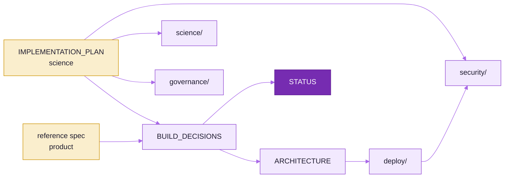

<picture>
  <source media="(prefers-color-scheme: dark)" srcset="readme-kit/assets/hero-dark.svg">
  
</picture>

# Documentation

Every document about the system, grouped by the question it answers. The plan is the scientific source of truth,
the build decisions settle where the plan and the product spec differ, and the status page says what exists.

## &nbsp; Start here

| Question | Document |
|---|---|
| What is built, what is validated, what is missing? | [STATUS.md](STATUS.md) |
| What are the constructs, indicators, gates and features (`ENG-07`, `SCR-01`, ...)? | [IMPLEMENTATION_PLAN.md](IMPLEMENTATION_PLAN.md) |
| Which decisions bind this build, and how have they moved? | [BUILD_DECISIONS.md](BUILD_DECISIONS.md) |
| How is the repository laid out and how does each part run? | [ARCHITECTURE.md](ARCHITECTURE.md) |
| What product shape (routes, DB domains, API groups, dashboards) does the spec ask for? | [reference/agent-implementation-spec.md](reference/agent-implementation-spec.md) |

## &nbsp; Deployment

| Document | Covers |
|---|---|
| [deploy/aws-ec2.md](deploy/aws-ec2.md) | The EC2 t3.small host, Caddy, SSM secrets, deploy and rollback, kiosk device tokens, synthetic data on production, the Vercel console, Google sign-in, secret rotation, costs, teardown, live checks |
| [deploy/supabase.md](deploy/supabase.md) | The Supabase project, the research and identity databases and their roles, the session pooler, migrations, Data API lockdown, PostgreSQL 17 compatibility, backups |

## &nbsp; Science

| Document | Covers |
|---|---|
| [science/indicator-review.md](science/indicator-review.md) | Estimators, indicators that can never be scored, the effort-discounting design |
| [science/VAL-02-trial-requirements.md](science/VAL-02-trial-requirements.md) | Minimum trials per indicator, from the simulation study |
| [science/amendments/2026-10-wave2.md](science/amendments/2026-10-wave2.md) | Wave 2 changes to dictionary phases, trial minimums and module budgets |

## &nbsp; Security

| Document | Covers |
|---|---|
| [security/README.md](security/README.md) | Index, where things stand, top actions before Stage 2, re-running the scans |
| [security/threat-model.md](security/threat-model.md) | STRIDE analysis of the kiosk, transport, API, data platform, web app and insiders |
| [security/data-flows.md](security/data-flows.md) | Data-flow diagrams with trust boundaries, the key hierarchy, erasure, and the pilot as deployed |
| [security/controls-matrix.md](security/controls-matrix.md) | Every control mapped to features, threats, status and verification |
| [security/scan-findings.md](security/scan-findings.md) | Scan results and findings SF-01 to SF-16, with their status today |
| [security/pentest-checklist.md](security/pentest-checklist.md) | Test cases per surface, Stage 2 blockers |
| [security/kiosk-hardening-ubuntu-core.md](security/kiosk-hardening-ubuntu-core.md) | The Ubuntu Core 24 kiosk image and its lockdown |
| [security/supply-chain-policy.md](security/supply-chain-policy.md) | Dependency intake, lockfiles, CI scanners, signing, current state |

## &nbsp; Governance

All drafts, none approved; no participant data may be collected until they are.

| Document | Covers |
|---|---|
| [governance/README.md](governance/README.md) | Index, review markers, evidence pack, change control |
| [governance/dpia.md](governance/dpia.md) | Data Protection Impact Assessment under the DPDP Act 2023, with the pilot's processors |
| [governance/consent/README.md](governance/consent/README.md) | The seven consent scripts and the rules every script follows |
| [governance/irb-protocol.md](governance/irb-protocol.md) | IEC/IRB protocol, Stages 1 to 5 |
| [governance/data-management-plan.md](governance/data-management-plan.md) | Data description, provenance, storage, sharing and preservation |
| [governance/retention-and-deletion-policy.md](governance/retention-and-deletion-policy.md) | Retention schedule and the erasure workflow |
| [governance/access-control-policy.md](governance/access-control-policy.md) | Roles, access matrix, authentication, account lifecycle |
| [governance/incident-response-runbook.md](governance/incident-response-runbook.md) | Severity, phases and deadlines, playbooks, notifications |
| [governance/report-use-statement.md](governance/report-use-statement.md) | What a player report may and may not be used for |
| [governance/minors-policy.md](governance/minors-policy.md) | Adults only, locked |

## &nbsp; Visuals

| Document | Covers |
|---|---|
| [readme-kit/README_STYLE.md](readme-kit/README_STYLE.md) | The shared README visual system: templates, tokens, mermaid palette, motion, CI |
| [screenshots/wave3/README.md](screenshots/wave3/README.md) | The wave 3 art-direction storyboard |

<picture>
  <source media="(prefers-color-scheme: dark)" srcset="readme-kit/assets/footer-dark.svg">
  
</picture>
