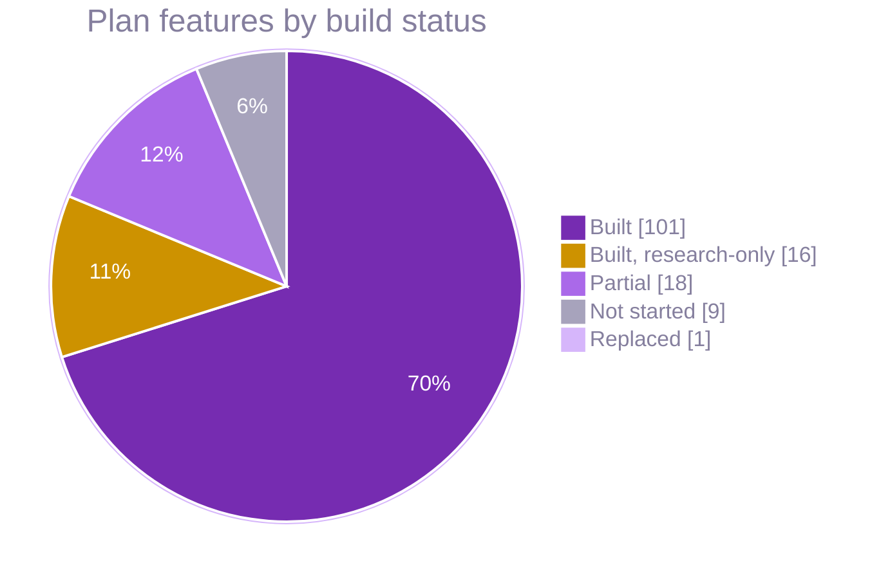

<picture>
  <source media="(prefers-color-scheme: dark)" srcset="readme-kit/assets/stats-dark.svg">
  
</picture>

# Build status

**As of 2026-11-04 (`main` at `b142b4c`, PR #10).** Both pathways play end to end in the browser kiosk and the
Electron runtime: attract, onboarding, Pathway A (three episodes) or Pathway B (carousel of micro-games), report,
survey and farewell. Events reach the API and the scoring jobs run. The production pilot is live on synthetic
data only. Nothing is validated on real participants yet: every scientific output is research-only, and player
reports stay behind the release gate (fail closed).

<picture>
  <source media="(prefers-color-scheme: dark)" srcset="readme-kit/assets/timeline-dark.svg">
  
</picture>

## Since 2026-10-22

| PR | Merged | What changed |
|---|---|---|
| #7 | 2026-11-01 | brotli 1.2.1 (GHSA-9v8h-qqgm-4m35); npm advisories that osv-scanner 2.7 newly reads in `pnpm-lock.yaml` fixed by overrides, one time-boxed exception (`minimatch` 3.1.5, expires 31 Dec); every action pinned to its latest release SHA (Node 24 runtimes, CodeQL v4); load-test plans draw ids from `os.urandom`, ending the `retry-50k` id collisions; `kiosk-release` exports `SOURCE_DATE_EPOCH` where it is read |
| #8 | 2026-11-01 | Dependabot replaces Renovate (which never ran): npm, uv, GitHub Actions, Docker, Compose and OpenTofu, weekly, grouped, 7-day soak, 30 days for majors |
| #9 | 2026-11-02 | Console, kiosk fallback screens and card-sort staff screens follow the field-repo frontend rules (purple-700 action colour, island nav, `ActionGroup`, axe-clean contrast in light and dark); migration `0008` and the admin routes behind every console control: signed kiosk remote commands, users and grants, policy signing, retention policy and legal holds, content-line ITC sign-off, audio takes, game drafts; kiosks pin the release-pack key and fall silent while locked |
| #10 | 2026-11-02 | EC2 host moves from t3.medium to t3.small with compose memory caps (api 700m, worker 600m, caddy 128m) and a 2 GiB swapfile in user data |

Feature IDs refer to [`IMPLEMENTATION_PLAN.md`](IMPLEMENTATION_PLAN.md). Binding rules are in
[`BUILD_DECISIONS.md`](BUILD_DECISIONS.md) and the layout is in [`ARCHITECTURE.md`](ARCHITECTURE.md).

Legend: **Built** = code and tests in the repo, run in CI. **Partial** = built but with a named gap.
**Not started** = no implementation yet. "Built" never means validated; see [Validated vs research-only](#validated-vs-research-only).

## Features by area

### PLT: Platform foundations

| Status | Features |
|---|---|
| Built | PLT-01 monorepo, PLT-02 contracts (Ajv + Pydantic parity), PLT-03 version tuple and manifest stamping, PLT-04 CI/CD, PLT-06 observability, PLT-08 plan lint, PLT-09 governance sign-off repository |
| Partial | PLT-05 OpenTofu modules exist in `infra/tofu` but are unused; the production pilot runs on one EC2 t3.small (Docker Compose, `infra/ec2` scripts) with Supabase Postgres and the console on Vercel, dev on Docker Compose |
| Replaced | PLT-07 Metabase is replaced by the custom research dashboards in `frontend/apps/web` (BUILD_DECISIONS) |

### KSK: Kiosk shell, hardware and fleet

| Status | Features |
|---|---|
| Built | KSK-01 kiosk shell (browser-first Vite build plus Electron runtime), KSK-02 session statechart, KSK-03 attract loop, KSK-04 idle/walkaway/abandon, KSK-05 icon-first UI kit, KSK-06 accessibility, KSK-07 encrypted offline outbox, KSK-12 privacy from onlookers |
| Partial | KSK-08 HAL (no reference SKU certified), KSK-09 Ubuntu Core image, KSK-10 fleet provisioning and remote commands (lock, unlock, restart, sync, pull logs and wipe are Ed25519-signed, run only while the kiosk idles in attract and are acknowledged; never run on a fleet), KSK-11 signed OTA (built in CI, never run on a fleet), KSK-14 low-spec hardening (not measured on kiosk hardware) |
| Not started | KSK-13 pilot and admin mode on the kiosk (NFC or rotating picture PIN); the kiosk build still has only the development PIN panel |

### VOX: Audio, speech and localisation

| Status | Features |
|---|---|
| Built | VOX-01 playback engine, VOX-02 audio asset pipeline, VOX-03 guide character, VOX-07 localisation workflow, VOX-08 cultural variants as forms |
| Partial | VOX-04 closed-vocabulary ASR (`asr-sherpa`, opt-in, not field-tested), VOX-05 audio front end, VOX-06 ASR bake-off harness (no bake-off run on recorded speech) |
| Not started | VOX-09 scale-out to 22 languages (P2; three language drafts exist) |

### ONB: Onboarding and consent

| Status | Features |
|---|---|
| Built | ONB-01 language by speaking faces, ONB-02 spoken consent with mandatory tap, ONB-03 contact opt-in and retest token, ONB-04 bands by picture, ONB-05 practice merged with the warm-up (fair-world `WarmupModule`: tap, hold, say-or-touch with hand demonstrations on the unchanged `warmup.json` trials), ONB-06 stop and withdrawal, ONB-07 micro-survey, ONB-08 session budget enforcement and timeline simulation |

### ENG: Game engine

| Status | Features |
|---|---|
| Built | ENG-01 timing service, ENG-03 seeded RNG, ENG-04 content-as-config with build checks, ENG-05 module contract, ENG-06 input layer, ENG-07 logger SDK, ENG-08 indicator declarations, ENG-09 trial scheduler, ENG-10 warm-up and level policy, ENG-11 no visible score, ENG-14 retest parallel forms |
| Partial | ENG-02 calibration rig in `tools/timing-calibration`; no kiosk SKU is certified, so scoring treats every device as uncertified |
| Not started | ENG-12 adaptive selector (P2), ENG-13 indicator health toggles (P2) |

### MG: Pathway B micro-games

| Status | Features |
|---|---|
| Built | MG-01 Balloon Pump, MG-02 Don't-Tap, MG-03 Card Sort, MG-04 Tower, MG-05 Share-the-Pot, MG-06 Private Dice (group level only), MG-07 Wait-or-Now, MG-08 Steady Hands, MG-09 Four Stalls, MG-10 carousel hub |
| Not started | MG-11 stop-signal substudy block (P2) |

### EPI: Pathway A episodes

| Status | Features |
|---|---|
| Built | EPI-01 The Stall, EPI-02 The Weighing Post, EPI-03 The Road Home, EPI-04 Pathway A orchestrator, EPI-05 pilot arm assignment |
| Partial | EPI-06 co-play: scripted-partner content and partner rating exist; the live-dyad substudy is not built |
| Not started | EPI-07 Pathway C voiced SJT carousel (P2) |

### ING: Logging, ingestion and data management

| Status | Features |
|---|---|
| Built | ING-01 event envelope and catalogue, ING-02 ingestion API, ING-04 dead-letter queue and replay, ING-05 session reconstruction, ING-06 analysis snapshots, ING-07 replay and timeline viewer, ING-08 raw store with per-session encryption |
| Partial | ING-02 performance target missed (see known gaps); ING-03 schema-compatibility gate runs in CI, but no upcaster has been needed yet |

### SCR: Scoring dictionary and indicators

| Status | Features |
|---|---|
| Built | SCR-01 to SCR-13: dictionary schema, registry, v0 content and budget sheet, all indicator families, style traits, calibration-level rules, data-quality flags, reproducible runs with lineage |
| Note | The dictionary is a v0 draft, not frozen. Wave 2 changes are in `docs/science/amendments/2026-10-wave2.md` |

### CRT: Criterion battery and study management

| Status | Features |
|---|---|
| Built | CRT-01 to CRT-11: research data model, instrument bank, licensing tracker, scoring keys, ODK and card-sort capture, pseudonymous linkage, study/quota engine, think-aloud mode, performance criteria, retest scheduler and contact vault, pre-registration |
| Note | Licensed item text is not in the repo; it loads at administration time from the licensed source |

### VAL: Validation analytics and gates

| Status | Features |
|---|---|
| Built (research-only) | VAL-01 R package and bridge, VAL-02 power and trial budgets, VAL-03 descriptives, VAL-04 reliability, VAL-05 test-retest, VAL-06 MTMM validity, VAL-07 factor structure, VAL-08a and VAL-08 invariance, VAL-09 DIF, VAL-10 incremental validity, VAL-11 norming, VAL-14 gate service, VAL-15 Quarto reports, VAL-16 fairness watch, VAL-18 supervised vs unattended |
| Partial | VAL-13 Pathway B vs A comparison exists only as a section of the Stage 2 pilot report |
| Not started | VAL-12 indicator retention scorecard, VAL-17 de-identified research export (policy documents only) |

### REP: Player report

| Status | Features |
|---|---|
| Built | REP-01 composite and band service, REP-02 report delivery (thank-you, demo, player modes), REP-03 signed, expiring release pack |
| Gated | Player mode is disabled until the battery gate passes in at least two language groups; kiosks show the thank-you report |

### PRV: Privacy, security and governance

| Status | Features |
|---|---|
| Built | PRV-01 deployment policy (signed from the admin console), PRV-02 consent ledger, PRV-03 audio non-retention, PRV-04 identity vault, PRV-05 retention engine, PRV-06a minimal erasure, PRV-06 crypto-shredding erasure, PRV-07 encryption and keys, PRV-08 RBAC and audit (five API roles, permission-matrix test in CI; staff accounts and study grants managed from `/admin`), PRV-11 IRB evidence pack, PRV-12 DPIA and adults-only preconditions |
| Partial | PRV-09 threat model and controls matrix (open findings, e.g. SF-01 ingestion overload), PRV-10 incident-response runbook (documents only, not exercised) |
| Not started | PRV-13 tamper-evident audit chain and SIEM (deferred, P2) |

### QA: Testing and quality

| Status | Features |
|---|---|
| Built | QA-01 scoring unit, property and parity tests, QA-02 synthetic player simulator and parameter recovery, QA-03 golden-session fixtures |
| Partial | QA-04 end-to-end: full-session bot playthroughs of both pathways and kiosk -> API -> scoring run on every PR; no hardware-in-the-loop. QA-05 load and soak tests exist and fail the ING-02 target |

## Features at a glance

All 145 plan features, counted from the tables above. A range such as SCR-01 to SCR-13 counts in full, VAL-08a
and PRV-06a count on their own, and a feature listed under two statuses counts once, under the weaker one.



## Validated vs research-only

<picture>
  <source media="(prefers-color-scheme: dark)" srcset="readme-kit/assets/timeline-stages-dark.svg">
  
</picture>

No stage of the research programme has started. Stage 1 (think-aloud, 30 to 40 people per pathway) needs the
evidence pack and IEC approval in [`governance/`](governance/README.md) first.

**Verified by tests and CI (engineering correctness):**

- Event contracts: kiosk and server validate the same fixtures; every bot session event passes the strict validator, `seq` is gapless.
- Kiosk -> API: 963 of 963 events accepted in CI, event ids match the kiosk outbox, session closes as completed.
- Session budgets: both pathways complete within the 900 s cap in CI bot runs (Pathway A ceilings 865 s, Pathway B 890 s).
- Scoring formulas, dictionary integrity, scheduler constraints, content budgets, erasure and retention, RBAC.
- Parameter recovery on simulated players (`stats/simulator`), including the demo pipeline end to end.

**Research-only (not validated on people, never shown to players):**

- Every behavioural indicator, composite and trait estimate. No participant data has been collected.
- Reliability, validity, invariance, DIF and norming analyses: run only on synthetic data.
- Gates in `stats/measurement-model/gates.yaml` have never passed, so player reports stay disabled.

## Known gaps

- **Timing on real kiosk hardware is unverified.** No SKU is certified (ENG-02). The CI kiosk -> API -> scoring
  job builds with the test-only `ci-headless-test` profile (E2E bridge builds only; refused by the API outside
  ENV=dev/test; sessions graded `caution`, never reportable). The bot injects its taps in-page there, because CDP
  pointer events on a blocked main thread get 5-20 ms latencies. The job requires real values for the Don't-Tap
  indicators `premature_taps`, `extra_taps` and `rt_rvi`. On GPU-less runners a frame takes 0.5-2.5 s and modules
  end on their hard caps in wall time, so the job accepts, with a warning, a Don't-Tap that hit its 108 s cap or
  a warm-up L1 fallback; a session excluded for quality or timing fails. Under heavy CPU load modules overran their
  hard caps (Don't-Tap ran 173 s against a 108 s cap), so cap enforcement must be checked on kiosk hardware.
- **Native-speaker recordings pending.** No recorded voice manifest is bundled; the kiosk runs the silent voice.
  Weighing Post lines, the form-specific new-rule line and the optional Road Home hint lines are still missing from `content/i18n/lines.yaml`.
- **Translations are machine drafts pending native review.** hi-IN, mr-IN and ta-IN are LLM-assisted drafts
  (`draft_machine_needs_native_review`); back-translations must be redone independently.
- **Composure accuracy slope has no signal on Pathway A** (`no_reliable_signal`, `docs/science/indicator-review.md`).
- **Ingestion p95 is above the ING-02 target.** Target p95 < 300 ms per 500-event batch at 50 kiosks; measured
  tens of seconds at 50 kiosks and 1.5 to 4 s with one kiosk (`tools/loadtest/RESULTS.md`, open finding SF-01).
- **Measurement-model review needed:** recovery test tolerance .08 for `emotional_regulation.mirroring` (.06 elsewhere);
  segment ceilings were cut (onboarding 80 s, report and survey 75 s, contact opt-in 20 s) to fund measured module budgets.
- **Card Sort** switch position varies over 3 positions instead of 5; VAL-02's +5 post-switch trials do not fit the budget.
  Wait-or-Now `choice_consistency` and `effort_completion_rate` stay `not_scorable_v1` for the same reason.
- **Art and content:** the Steady Hands lit-lamp glow washes the frame
  (measurement owners to decide); wave 2 screenshots under `docs/screenshots/wave2` were not regenerated (wave 3 storyboard is current).
- **Production pilot deployment, synthetic data only.** <https://behavioural-games.vercel.app> (Vercel) serves the
  web app against the FastAPI backend and worker on one EC2 t3.small (`docs/deploy/aws-ec2.md`, image `1c2c87c`,
  migration `0008`) and Supabase Postgres 17 on the Pro plan with an 8 GB disk (`docs/deploy/supabase.md`). Staff sign in with password accounts
  (`AUTH_MODE=local`); Google sign-in is built but stays off until a Google OAuth client id is configured. The
  public `/kiosk` never uploads. The database holds only synthetic studies. An unexplained read-only incident at
  about 838 MB on 2026-10-22 (far below the 8 GB disk) is still open. No kiosk fleet, Ubuntu Core image rollout or
  OTA ring has run outside CI. Preview deployments stay on the in-app demo API.

## Live checks (2026-11-04)

| Check | Result |
|---|---|
| `https://behavioural-games.vercel.app/`, `/login`, `/kiosk` | 200 |
| `/readyz` through Vercel and directly on the EC2 host | 200, `{"database":"ok","identity_database":"ok","migration":"0008"}` |
| Running images | api and worker `1c2c87c` (PR #9), both healthy, up 2 days |
| Host memory (t3.small, 1.9 GiB) | api 206 MiB of 700, worker 143 MiB of 600, caddy 13 MiB of 128; 1.0 GiB available, swap 16 KiB used, load 0.03 |
| Scheduled CI on `main` | Nightly simulation, OSV-Scanner, Load test, Measurement science and CodeQL all green on 2 to 4 Nov |

## How to run

Prerequisites, setup and everyday commands are in the [root README](../README.md). The short version:

```bash
pnpm install && uv sync --all-packages

# Kiosk game (no database needed)
pnpm --filter @shriii/kiosk dev                # http://localhost:5173 full session
#   ?module=<id> opens one module in the dev harness (dev and test-bridge builds), e.g. ?module=dont_tap

# Unit tests and checks (no database)
pnpm -r typecheck && pnpm lint && pnpm -r --workspace-concurrency=1 test
uv run ruff check . && uv run ruff format --check . && uv run mypy && uv run pytest   # DB tests skip without PostgreSQL

# Bot playthrough of one full session against a test-bridge build
VITE_E2E_BRIDGE=true pnpm --filter @shriii/kiosk exec vite build --outDir dist-e2e
pnpm --filter @shriii/kiosk exec vite preview --outDir dist-e2e --port 4180 &
node frontend/apps/kiosk/e2e/full-session.mjs --url http://127.0.0.1:4180 --pathway A --cap-s 900

# API, worker and research web app (needs PostgreSQL 18; CI runs these)
uv run shriii-api migrate && uv run shriii-api seed --demo
uv run shriii-api serve                         # API on :8000
uv run shriii-api worker                        # job worker (scoring, snapshots, retention)
uv run shriii-api demo-pipeline --fast          # synthetic sessions -> scoring -> validation
pnpm --filter web dev                           # http://localhost:3000 (/research, /admin)
```

CI (`.github/workflows/`) runs everything above plus the database-backed pytest suite, the migrations matrix on
PostgreSQL 17 and 18, Playwright smoke and live research-page tests, the mocked-API Playwright job with axe at
desktop, tablet and phone in light and dark, the session E2E workflow (`session-e2e.yml`), Docker image builds,
CodeQL, OSV-Scanner, R and Electron jobs, and `readme-check.yml` for the README and its kit. On schedule: the
nightly simulation, the nightly VAL-02 measurement-science study, the nightly load-test suite, a daily OSV scan
and a weekly CodeQL scan. Dependabot opens grouped weekly updates.
