# Governance, ethics and data protection

This folder holds the governance documents for the SHRIII Kiosk Behavioural Games research programme:
the DPIA, consent scripts, the IEC/IRB protocol draft, the data management plan and the operating
policies. They implement the privacy and ethics rules of `docs/IMPLEMENTATION_PLAN.md` (sections 1.3,
1.4, 5.13 PRV-01 to PRV-13, 6.3) and `docs/BUILD_DECISIONS.md` (non-negotiables 4 to 7).

**Status: DRAFT v0.1 (2026-10-21).** No document here is approved. Each one becomes effective only when
the approvals listed below are recorded as a signed governance record (PLT-09). Until then, the
technical defaults in code (fail closed, adults only, no audio kept, no camera) apply, and no
participant data may be collected.

**Production pilot (checked 2026-11-04).** A pilot deployment is live with **synthetic data only**: the console on
Vercel, the API and worker on AWS EC2 in Mumbai, and the research database and identity vault on Supabase in
Mumbai ([../deploy/](../deploy/aws-ec2.md)). It holds no participant data and must not receive any until these
documents are approved and the DPIA names those processors ([dpia.md](dpia.md#9-processors-and-transfers)).

```mermaid
%%{init: {"theme":"base","themeVariables":{"fontFamily":"Inter, ui-sans-serif, system-ui, -apple-system, Segoe UI, Roboto, Helvetica, Arial, sans-serif","fontSize":"15px","primaryColor":"#F2E9FE","primaryTextColor":"#1E1B2E","primaryBorderColor":"#9148D2","secondaryColor":"#FAEECD","secondaryTextColor":"#1E1B2E","secondaryBorderColor":"#CD9200","tertiaryColor":"#F3F1FA","tertiaryTextColor":"#1E1B2E","tertiaryBorderColor":"#A7A3BC","mainBkg":"#F2E9FE","nodeBorder":"#9148D2","nodeTextColor":"#1E1B2E","lineColor":"#AA69E9","textColor":"#857F9E","edgeLabelBackground":"#F9F5FF","clusterBkg":"#F9F5FF","clusterBorder":"#D6B6FB","titleColor":"#762CB1","noteBkgColor":"#FAEECD","noteTextColor":"#1E1B2E","noteBorderColor":"#CD9200","actorBkg":"#F2E9FE","actorBorder":"#9148D2","actorTextColor":"#1E1B2E","actorLineColor":"#AA69E9","signalColor":"#AA69E9","signalTextColor":"#857F9E","labelBoxBkgColor":"#F2E9FE","labelBoxBorderColor":"#9148D2","labelTextColor":"#1E1B2E","loopTextColor":"#857F9E","activationBkgColor":"#E7D5FE","activationBorderColor":"#9148D2","sequenceNumberColor":"#FFFFFF","transitionColor":"#AA69E9","transitionLabelColor":"#857F9E","stateLabelColor":"#1E1B2E","stateBkg":"#F2E9FE","compositeBackground":"#F9F5FF","compositeTitleBackground":"#F2E9FE","attributeBackgroundColorOdd":"#FFFFFF","attributeBackgroundColorEven":"#F9F5FF","relationColor":"#AA69E9","relationLabelBackground":"#F9F5FF","relationLabelColor":"#1E1B2E"}}}%%
flowchart LR
  D["Draft in a branch"] --> R["CODEOWNERS review<br/>DPO, Ethics Officer"]
  R --> I{"Affects<br/>participants?"}
  I -->|yes| IEC["IEC approval<br/>new recordings via ITC"]
  I -->|no| S
  IEC --> S["Signed governance record<br/>PLT-09, commit SHA"]
  S --> E["Effective; hash in the<br/>next evidence pack"]
  classDef accent fill:#762CB1,stroke:#5F1C93,color:#FFFFFF
  classDef gold fill:#FAEECD,stroke:#CD9200,color:#1E1B2E
  class S accent
  class IEC gold
```

## Review markers

The markers below appear in the text. Each must be resolved, and the marker removed, before approval.

| Marker | Meaning | Who resolves it |
|---|---|---|
| **[LEGAL REVIEW]** | A legal interpretation or obligation (DPDP Act 2023, DPDP Rules 2025, IT Act / CERT-In directions, contract law) that a qualified Indian data-protection lawyer must confirm | Legal counsel, with the DPO |
| **[IEC REVIEW]** | An ethics decision for the Institutional Ethics Committee (deception, debriefing, compensation, consent mode, vulnerable groups) | Ethics Officer, then the IEC |
| **[STAKEHOLDER REVIEW]** | A programme decision (languages, sites, report use, retention periods marked "proposed", named people) | PI and sponsor |
| **[TBD: ...]** | A fact to fill in (names, addresses, phone numbers, registration numbers) | Document owner |

## Documents

| Document | Plan features | Owner | Approvers | Status |
|---|---|---|---|---|
| [dpia.md](dpia.md): Data Protection Impact Assessment (DPDP Act 2023) | PRV-12, PRV-02 to PRV-07 | DPO | DPO, legal counsel, PI | Draft |
| [consent/](consent/README.md): consent scripts per kind | ONB-02, ONB-03, PRV-02, VOX-07 | Ethics Officer | Ethics Officer, IEC, DPO | Draft |
| [irb-protocol.md](irb-protocol.md): IEC/IRB protocol draft, Stages 1 to 5 | PRV-11, CRT-07 | PI | IEC | Draft |
| [data-management-plan.md](data-management-plan.md) | PRV-11, ING-06, VAL-17 | Research Lead | PI, DPO | Draft |
| [retention-and-deletion-policy.md](retention-and-deletion-policy.md) | PRV-05, PRV-06a, PRV-06 | DPO | DPO, legal counsel | Draft |
| [access-control-policy.md](access-control-policy.md) | PRV-04, PRV-07, PRV-08 | Security lead | DPO, PI | Draft |
| [incident-response-runbook.md](incident-response-runbook.md) | PRV-10, PRV-09 | Security lead | DPO, legal counsel | Draft |
| [report-use-statement.md](report-use-statement.md) | Plan 1.4 `report_use_statement_key`, REP-02 | PI | PI, Ethics Officer, legal counsel | Draft |
| [minors-policy.md](minors-policy.md): 18+ locked | Plan 1.4 `allow_minors=false`, PRV-12 | DPO | DPO, Ethics Officer, legal counsel | Draft |

Related machine-readable sources (these documents must agree with them):

- `backend/api/src/shriii_api/config/retention.yaml`: the retention engine's rule set (PRV-05).
- `backend/api/src/shriii_api/auth/rbac.py`: the implemented role and permission matrix (PRV-08).
- `contracts/schemas/consent-artefact.v1.schema.json`: the consent kinds and the consent record.
- `stats/measurement-model/gates.yaml`: the report display rule and the battery release gate.
- `stats/prereg/`: the pre-registration generator (its output is part of the ethics evidence pack, PRV-11).

## Evidence pack (PRV-11)

For each study and wave, the evidence pack holds: the approved protocol and IEC approval letter; the
consent scripts with their audio SHA-256, transcripts and back-translations; this DPIA and its document
hash; the data management plan; the policies in this folder; the pre-registration (generated by
`shriii-prereg`, with its input hashes) and the VAL-02 power report; the complaint log; erasure statistics;
gate history; and staff training records. When a policy changes, the hash of the new version goes into the
next pack.

## Change control

1. Edit the Markdown in a branch, and state the reason in the commit message.
2. CODEOWNERS approval: DPO for data protection documents, Ethics Officer for consent and protocol, two
   people for any policy (PLT-09).
3. A change that affects participants (consent wording, retention, report use, new data) needs IEC
   approval before use, and new consent recordings go through the ITC workflow (VOX-07).
4. The signed governance record carries the commit SHA of the approved text.
