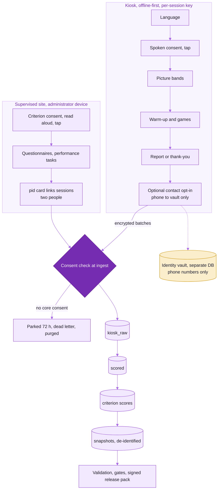

# Data Protection Impact Assessment (DPIA)

**Programme:** SHRIII Kiosk Behavioural Games: research on game-based behavioural indicators
**Law:** Digital Personal Data Protection Act, 2023 (DPDP Act) and Digital Personal Data Protection Rules, 2025 (DPDP Rules)
**Version:** 0.1 DRAFT, 2026-10-21. **Owner:** Data Protection Officer (DPO). **Plan feature:** PRV-12.
**Approvers:** DPO, legal counsel, Principal Investigator (PI). The document hash goes into the IEC evidence pack (PRV-11).

> **[LEGAL REVIEW]** The DPDP Act does not make a DPIA mandatory unless the Central Government notifies
> the Data Fiduciary as a Significant Data Fiduciary (section 10). This programme carries out a DPIA anyway,
> because it processes behavioural data from members of the public at kiosks, including people with low
> literacy. Counsel must confirm the reading of every section cited here against the notified text of the
> Act and the Rules, including the commencement dates of each obligation.

---

## 1. Parties and roles

| DPDP role | Who | Notes |
|---|---|---|
| Data Fiduciary | [TBD: legal entity running the study] | Decides purposes and means. Named in the consent audio and on the kiosk QR. |
| Data Processor(s) | Cloud hosting provider (India region); IVR provider for retest reminders; SMS provider (optional) | Processing only under a written contract (section 8(2)). See section 9. |
| Data Principal | Adult participants (18+) at supervised sites and open public kiosks | No children (section 12 and the [minors policy](minors-policy.md)). |
| Contact for questions (section 8(9)) | [TBD: DPO name, phone, email, postal address] | Given through the bezel QR code and spoken in the consent audio. |
| Grievance redressal (section 8(10), section 13) | [TBD: grievance officer, phone line staffed in the pilot languages] | Complaints reach the Ethics Officer within 24 hours (PRV-11 acceptance criterion). |
| Data Protection Board of India | Escalation route for Data Principals (section 13(3)) | The consent audio tells participants they can complain to the Board. |

## 2. Description of the processing

### 2.1 Purposes

| ID | Purpose | Consent kind (plan 6.3) | Data used |
|---|---|---|---|
| P1 | Run the game session and, after the release gate opens, give the player a strengths-framed picture report | `core` | Session events, picture-band answers |
| P2 | Research on the measurement properties of the games (reliability, validity, fairness, norms) | `core` (study sessions) and `criterion` | Events, indicators, questionnaire answers, performance tasks, picture bands |
| P3 | Keep de-identified data in a research archive for future studies and sharing with other researchers | `archive` (separate tick, default no) | De-identified indicators, events and bands |
| P4 | Contact the player later for a retest visit | `contact` (separate yes/no after the report, default no) | Phone number (identity vault only) |
| P5 | Live two-player co-play substudy and partner ratings | `coplay_substudy` | Events with player slot, private partner ratings |
| P6 | Evaluate speech recognition for short spoken answers (ASR bake-off) | `asr_eval` | Short audio clips of closed-vocabulary words, age band, gender |
| P7 | Think-aloud usability study (Stage 1) | `research_audio` | Audio recording of the participant talking while playing, observer codes |
| P8 | Operate and secure the kiosks and the platform | Legitimate use: not consent-based personal data processing. Telemetry is kept device-level and must not identify a person | Device health, timing quality, security logs, staff audit trail |

Purposes that are **out of scope and technically prevented**: clinical diagnosis; hiring or any high-stakes
decision; individual integrity or honesty judgements (the private-dice task is analysed at group level
only, and the true roll is never logged); camera, facial expression and voice tone as trait signals
(compiled out of the builds, no consent kind exists); continuous listening (the microphone is closed outside
consented prompt windows); runtime text-to-speech.

### 2.2 Data inventory

"Identifiable" means directly identifying (I), pseudonymous (P, linked through a random participant id
`pid` or a `session_id`), or anonymous/aggregate (A).

| Data class | Examples | Identifiability | Where stored | Purpose(s) | Collected from |
|---|---|---|---|---|---|
| D1 Raw game events | Taps, choices, response latencies, trial positions, timing flags, input mode, language chosen | P (`session_id`, `pid` once linked) | Kiosk outbox (encrypted per session) then `kiosk_raw` (encrypted object store and PostgreSQL) | P1, P2 | Kiosk |
| D2 Session context and picture bands | Age band, literacy band, schooling band, gender (optional), smartphone use, played before; each has "prefer not to say" | P (coarse bands only, no exact age, no name) | `kiosk_raw`, `scored` | P1, P2 | Kiosk |
| D3 Derived indicators and quality flags | Indicator values, model estimates, style indices, session quality grade | P | `scored` | P2 | Computed from D1, D2 |
| D4 Criterion battery answers and scores | Questionnaire item answers, scale scores, performance tasks (Tower of London board, card sort), administrator-rated cooperation | P (`pid`) | `criterion` | P2 | Administrator device at supervised sites |
| D5 Linkage records | `pid` to game sessions and criterion waves, pairing codes | P (restricted) | `linkage` | P2 | Administrator, QR card |
| D6 Consent artefacts | Kind, granted yes/no, script id, audio SHA-256, language, time, kiosk, replay counts | P | `consent` | Proof of consent (section 6(10)) | Kiosk, administrator device |
| D7 Contact details | Phone number for retest reminders, reminder channel, call outcome | **I** | Separate identity vault database with separate keys | P4 | Kiosk PictureDigitPad, after the report |
| D8 Participant report artefacts | Report token, bands shown (no numbers), language, expiry | P | `validation` / report store | P1 | Generated |
| D9 Co-play substudy data | Events with `player_slot`, `coplay_group_id`, private partner ratings, credit/blame allocations | P | `kiosk_raw`, `scored`, `criterion` | P5 | Kiosk (supervised) |
| D10 ASR evaluation clips | Short recordings of closed-vocabulary words, age band, gender, noise level | P (voice is potentially identifying) | Encrypted research store with deletion timer | P6 | Supervised session |
| D11 Think-aloud recordings and codes | Audio of the participant talking, observer codes, participant code | P (voice is potentially identifying) | Encrypted research store with deletion timer | P7 | Supervised session |
| D12 Analysis snapshots and exports | De-identified Parquet snapshots, de-identified research exports (archive consent only, k-anonymity >= 5) | P / A | `validation`, export store | P2, P3 | Built from D1 to D5 |
| D13 Decline counter | Count of declined consents per kiosk per day | A | `governance` | Study reporting | Kiosk |
| D14 Device telemetry | Device health, frame timing, sync status | A (device level; no player identifiers) | `governance.system_events` | P8 | Kiosk |
| D15 Security logs and staff audit trail | Staff logins, data access, exports with justification | I (staff only) | Append-only audit table, versioned export | P8 | Platform |
| D16 Backups | Encrypted database backups, wrapped session-key backups | As source | Separate backup keys | Resilience | Platform |

**Never collected:** name, exact date of birth, address, government identifiers (including Aadhaar), photos,
video, camera input, voice outside D10/D11, location beyond the site id, free text of any kind (there is
no keyboard), and any data from people who choose an under-18 age band.

### 2.3 Data flow



The same flow as text:

```text
Kiosk (offline-first, per-session key)                      Supervised site (administrator device)
  language -> spoken consent (tap) -> picture bands           criterion consent (read aloud, tap)
  -> warm-up -> games -> report or thank-you                  -> questionnaires, performance tasks
  -> optional contact opt-in (phone to vault only)            -> pid card links sessions (two people)
        |  encrypted batches over mutual TLS                             |
        v                                                                v
  Ingestion: consent check at ingest (no core consent -> parked 72 h -> dead letter -> purged)
        v
  kiosk_raw (raw events) -> scored (indicators) -> criterion scores -> analysis snapshots (de-identified)
        v                                                   v
  validation engine -> gates -> signed release pack     identity vault (separate DB): phone numbers only
```

### 2.4 Scale

Planned: about 1,350 Stage 2 participants (450 per language), 300 retest pairs, at least 120 co-play dyads,
at least 300 unattended-kiosk sessions per language, Stage 1 think-aloud 30 to 40 per pathway, and later
norming samples of 1,500 to 2,000 per language (likely after the grant). Open public kiosks in thank-you
mode may collect larger numbers of play-only sessions; those are deleted after 90 days.

## 3. Lawful basis and consent (sections 4 to 7)

### 3.1 Basis

All participant data (D1 to D12) is processed on the basis of **consent** (section 6). No participant data
relies on the "legitimate uses" of section 7. Device telemetry and staff security logs (D14, D15) relate
to devices and staff; staff processing rests on their employment terms. **[LEGAL REVIEW]** confirm the
basis for staff audit logging and for keeping security logs for one year.

The research exemption in section 17(2)(b) (processing for research, archiving or statistical purposes,
where the data is not used for any decision specific to the Data Principal and the prescribed standards
are followed) is **not relied on**. The programme gives participants the full set of rights instead.
**[LEGAL REVIEW]** confirm whether the exemption should be claimed for the archive (P3) and how it interacts
with the participant report (P1), which is an output for the individual.

### 3.2 How consent meets section 6

| Requirement | How it is met |
|---|---|
| Free | No reward depends on agreeing to the archive or contact opt-ins. Declining core consent ends the session politely; only an anonymous counter is kept. Compensation (supervised studies) is paid for attendance, not for consent to optional purposes. **[IEC REVIEW]** |
| Specific | Separate consent kinds per purpose (core, archive, contact, criterion, coplay_substudy, asr_eval, research_audio), each with its own decision and record. |
| Informed | Pre-recorded audio in the participant's language by a native speaker, in 3 to 4 short segments with pictograms, each replayable. Translations follow the ITC workflow (forward and back translation, expert review, think-aloud testing). See [consent scripts](consent/README.md). |
| Unconditional | Opt-ins are never bundled with play. Play is not conditional on archive or contact consent. |
| Unambiguous, clear affirmative action | Only a **tap** commits consent. Consent is never given by voice; the microphone is not open during consent. Opt-in ticks default to "no". A timeout or skip counts as "no". |
| Limited to necessary data | Data minimisation (section 2.2): coarse bands, no names, no free text, contact details only on opt-in. |
| Withdrawal as easy as giving | A persistent "hand" icon on the kiosk offers keep or delete at any time. Later withdrawal through the retest token or QR card, the helpline, or the study administrator. |
| Notice (section 5) | Delivered in the consent audio and through the QR code: the data collected, the purpose, how to withdraw and request erasure, how to complain, and how to complain to the Board. Available in English or any Eighth Schedule language (section 5(3)); the pilot languages are Eighth Schedule languages. |
| Proof of consent (section 6(10)) | An immutable consent artefact (plan section 6.3) records the script id and the SHA-256 of the exact audio played. Changes are superseding records. |

> **[LEGAL REVIEW]** Whether a tapped consent on a kiosk after audio notice, with no written signature,
> satisfies section 6 and the notice requirements of the Rules for participants who cannot read. The design
> assumption is yes, because the notice is given in audio in the participant's language and the
> affirmative action is unambiguous.
> **[IEC REVIEW]** ICMR National Ethical Guidelines (2017) allow oral/audio consent with documentation for
> minimal-risk research; the IEC must approve this consent mode explicitly.

### 3.3 Consent Managers

The programme does not use a registered Consent Manager. **[LEGAL REVIEW]** confirm that this is optional
for this processing.

## 4. Data Principal rights (sections 11 to 14)

| Right | How it is honoured | Time |
|---|---|---|
| Information about processing (s.11) | On request through the helpline or administrator: a plain-language summary (spoken or printed picture page) of what is held for the `pid` or session token, the purposes, and the processors | Within 30 days **[LEGAL REVIEW: confirm the period prescribed by the Rules]** |
| Correction and completion (s.12) | Picture-band answers can be corrected by the administrator on request; game events are records of play and are not "corrected", but may be erased | Within 30 days |
| Erasure (s.12) and withdrawal (s.6(4)) | Erasure workflow in [retention and deletion policy](retention-and-deletion-policy.md), section 4 | Primary stores within 72 hours; backups within 14 days |
| Grievance redressal (s.13) | Helpline in the pilot languages; logged in the complaint log; Ethics Officer informed within 24 hours | Response within the period the Rules prescribe **[LEGAL REVIEW]** |
| Nomination (s.14) | A participant can name a nominee through the administrator; the nominee can exercise rights on death or incapacity | On request |

Identity is checked with what the participant already holds (retest token, QR card, `pid` card) and the
answers to the picture-band questions. No extra identity documents are collected.

## 5. Necessity and proportionality

- **Minimisation.** Exact age is never asked; only life-stage bands. Gender is optional. No names. Contact
  numbers only after an explicit opt-in, and only in the identity vault, never in event tables.
- **Audio.** No audio is kept from game play. The closed-vocabulary speech recogniser, when enabled after the
  bake-off, runs on the kiosk and keeps only the recognised label and a confidence value. Audio is kept only
  under the separate `asr_eval` and `research_audio` consents, at supervised sites, encrypted, with deletion
  timers.
- **Public mode.** Open public kiosks run in thank-you mode with core consent only: no criterion battery, no
  contact unless the player opts in, no research audio, no co-play substudy. Play-only data is deleted after
  90 days.
- **Reports.** No participant report is shown until the battery release gate has passed in at least two
  language groups and been signed off. Reports show broad, strengths-framed bands, never numbers or negative
  labels, and say "a snapshot, not a diagnosis".
- **Integrity tasks.** The private-dice task never logs the true roll; integrity is estimated for groups,
  never for individuals.

## 6. Retention

Summary below; the full schedule, legal holds and the deletion mechanics are in the
[retention and deletion policy](retention-and-deletion-policy.md).

| Data class | Retention |
|---|---|
| D1 raw events, play-only sessions (not linked to a study participant, no archive consent) | 90 days |
| D1 to D5, D9 for study participants | Until study close-out plus the reproducibility period: **proposed 3 years after the final study report** **[STAKEHOLDER REVIEW] [LEGAL REVIEW]** |
| D6 consent artefacts | As long as any data collected under the consent exists, plus 3 years (proof of consent) **[LEGAL REVIEW]** |
| D7 contact details | Until the end of the retest study, or earlier on withdrawal; never beyond study end |
| D8 report artefacts | Token expiry plus 30 days |
| D10 ASR evaluation clips | Deleted within 30 days of the signed bake-off report, and no later than 6 months after capture |
| D11 think-aloud audio | Deleted within 30 days after coding |
| D12 de-identified archive (archive consent only) | Proposed 10 years **[STAKEHOLDER REVIEW]** |
| D14 telemetry | 90 days |
| D15 security logs and audit trail | 1 year (the DPDP Rules require logs for at least one year **[LEGAL REVIEW]**) |
| D16 backups and session-key backups | 14 days |

## 7. Erasure, including derived data and snapshots

Erasure covers every layer, not only raw events (full procedure in the retention policy, section 4):

1. **Kiosk:** local purge of the session and destruction of its session key (DEK) within 1 second; a
   tombstone keyed by `session_id` is queued so the server deletes events already uploaded and rejects late
   ones.
2. **Server primary stores (within 72 hours):** raw events, parked events, dead letters, derived
   indicators, model estimates, quality flags, criterion answers and scale scores, linkage rows, report
   artefacts, co-play data, the identity-vault record and any research audio.
3. **Crypto-shredding:** the wrapped session DEK is deleted, so encrypted raw objects and their versions in
   the object store become unreadable.
4. **Snapshots:** `snapshot_members` identifies every analysis snapshot that included the `pid`. Each is
   tombstoned and rebuilt without the person (an explicit rebuild step). Analysis runs on the old snapshot
   are labelled "reproducible modulo erasures"; their published aggregate results are not recalled.
5. **Exports:** the export recipient register is checked; recipients of de-identified exports that
   contained the person are notified under the data-use agreement.
6. **Backups:** expire within 14 days. A replay guard re-applies tombstones after any restore, so erased data
   cannot come back.
7. **Receipt:** a signed erasure receipt is issued. Only the receipt and a minimal tombstone (hashed
   identifiers needed to stop re-ingestion) are kept.

## 8. Risks and mitigations

Likelihood (L) and severity (S) on a 1 to 3 scale before mitigation; residual risk after mitigation.

| # | Risk to Data Principals | L | S | Mitigations | Residual |
|---|---|---|---|---|---|
| R1 | Participant does not understand what they agree to (low literacy, unfamiliar technology) | 3 | 2 | Native-speaker audio, pictograms, segment replay, ITC adaptation and think-aloud comprehension testing (Stage 1 exit gate), administrator present at supervised sites, defaults to "no" for opt-ins | Low-medium |
| R2 | Re-identification from pseudonymous data combined with bands, site and time | 2 | 2 | Coarse bands, separate vault, analysts see de-identified views only, k-anonymity >= 5 on exports, small-cell suppression (n < 30) in reports, no exact timestamps in exports **[STAKEHOLDER REVIEW: export time resolution]** | Low |
| R3 | Onlookers see or hear answers or the report at a public kiosk | 3 | 1 | No visible scores during play, no numbers in reports, phone digits confirmed by picture tiles or headset only (never speakers), privacy-from-onlookers features (KSK-12), report delivered by QR | Low |
| R4 | Report is misread as a diagnosis or used by others (employer, family) to judge the person | 2 | 3 | Reports disabled until gates pass; strengths framing; "snapshot not diagnosis"; personal reflection only ([report-use statement](report-use-statement.md)); no institutional use without re-consent and IEC review | Low-medium |
| R5 | Individual labelled dishonest from the integrity tasks | 1 | 3 | True dice roll never logged; integrity analysed at group level only; integrity capped at broad style or withheld in reports | Very low |
| R6 | Children take part | 2 | 3 | 18+ locked; under-18 band ends the session with nothing kept; supervised sites check apparent age; see [minors policy](minors-policy.md) | Low (self-declaration limits this) |
| R7 | Audio recorded without consent | 1 | 3 | Microphone closed outside consented prompt windows (tested), no audio in storage, logs, crash dumps or telemetry; research audio only at supervised sites with separate consent | Very low |
| R8 | Theft of a kiosk or administrator tablet | 2 | 2 | Per-session encryption, keys sealed in the TPM, mutual-TLS device certificates revocable within 5 minutes, remote wipe, offline data limited to unsynced sessions | Low |
| R9 | Breach of the server or the identity vault | 1 | 3 | Encryption in transit (TLS 1.3) and at rest, separate vault keys, RBAC with MFA, row-level security, audit trail, alarms on vault reads and anomalous exports, incident response ([runbook](incident-response-runbook.md)) | Low |
| R10 | Data kept longer than needed | 2 | 2 | Retention engine with nightly runs and reports, legal holds only with justification, backup expiry 14 days | Low |
| R11 | Erasure incomplete (derived data, snapshots, backups) | 2 | 2 | Erasure covers all layers including snapshots and backups (section 7), sweep query, erasure drill (restore plus tombstone replay) | Low |
| R12 | Unfair measurement disadvantages a language, literacy or age group | 2 | 2 | Invariance and DIF testing across required groupings before any release; differential exclusion limit; battery gate fails closed | Low-medium |
| R13 | Deception in scripted co-play partners causes distress or mistrust | 2 | 1 | Partners introduced as "pretend helpers" (`partner_disclosure`), debriefing, right to withdraw data after debriefing **[IEC REVIEW]** | Low |
| R14 | Processor misuse or transfer outside India | 1 | 2 | Contracts (section 9), India-region hosting, no transfer to countries restricted under section 16 | Low |
| R15 | Contact details misused (marketing, unrelated calls) | 1 | 2 | Vault access only for the retest scheduler and IdentitySteward, send path refuses anyone without contact consent, vault purged at study end | Very low |

## 9. Processors and transfers

- Written contracts with every processor (section 8(2)): processing only on instructions, confidentiality,
  security safeguards, breach notification to the Fiduciary without delay, deletion or return at contract
  end, sub-processor approval, audit rights.
- Hosting in an India region. No transfer of personal data outside India is planned. Section 16 permits
  transfers except to countries the Government restricts by notification; any future transfer needs a DPIA
  update. **[LEGAL REVIEW]**
- Processor list: [TBD: IVR provider], [TBD: SMS provider, optional], and the hosting processors below.
- Hosting processors of the production pilot (deployed 2026-10-22, synthetic data only as of 2026-11-04). Each
  needs a written contract and an entry here before real data arrives. **[LEGAL REVIEW]**

| Processor | Service | Region | Personal data it would hold |
|---|---|---|---|
| Supabase | Managed PostgreSQL: research database and the separate identity-vault database, daily backups kept 7 days | `ap-south-1` (Mumbai) | All research data classes; contact data in the vault |
| Amazon Web Services | EC2 host for the API and worker, SSM Parameter Store for keys, ECR for images | `ap-south-1` (Mumbai) | Data in transit and in process memory; keys |
| Vercel | Hosting of the staff console and its server-side proxy to the API | [TBD: confirm the function region] | Staff sign-in data and research data in transit to staff browsers |
| GitHub | Source code and CI | Not applicable | None: CI uses synthetic data only |

## 10. Personal data breach procedure (section 8(6))

Full procedure: [incident response runbook](incident-response-runbook.md). Summary:

1. **Detect and triage** (alarms on anomalous exports, authentication bursts, tamper, certificate misuse,
   vault reads). Incident Commander appointed within 1 hour of detection.
2. **Scope** the affected `pid`s and data classes within 4 hours (drill acceptance criterion PRV-10).
3. **Contain:** revoke device certificates, remote-wipe, rotate keys, suspend accounts, disable exports.
4. **Notify the Data Protection Board** without delay, with a detailed report within 72 hours of becoming
   aware, in the form the DPDP Rules prescribe. **[LEGAL REVIEW: confirm timelines and content]**
5. **Notify each affected Data Principal** without delay, in their language, in plain words: what happened,
   likely consequences, what we did, what they can do, and whom to contact. For participants who cannot
   read: a pre-recorded IVR call script in their language; SMS only as a supplement.
6. **CERT-In:** report reportable cyber incidents within 6 hours of noticing them (CERT-In Directions of
   28 April 2022). **[LEGAL REVIEW]**
7. **IEC:** inform the Ethics Committee as an unanticipated problem, within its SOP timeline. **[IEC REVIEW]**
8. Post-incident review within 10 working days; update this DPIA.

## 11. Age assurance (PRV-12)

- Age is **self-declared** at the kiosk by picture bands. An under-18 selection ends the session politely
  and nothing is persisted (tested: zero persisted data).
- At supervised sites the administrator does not ask for documents but ends the session if the participant
  is evidently a child.
- Public-mode sessions are minimised (thank-you mode, no criterion battery, no contact unless opted in).
- **[LEGAL REVIEW]** sought on the DPDP Rules for age assurance at anonymous kiosks: whether self-declaration
  without verification is sufficient where no verifiable identity is collected, given section 9 and the
  Rules on verifiable parental consent.
- The preconditions before minors could ever be enabled are in the [minors policy](minors-policy.md).

## 12. Consultation

| Who | How | When |
|---|---|---|
| Participants and communities | Stage 1 think-aloud sessions, comprehension of consent and report (demo mode) | Before Stage 2 |
| Language and cultural reviewers | ITC review of consent scripts and scenarios | Before recording |
| IEC | Protocol review including this DPIA | Before Stage 1 |
| Legal counsel | Review of all [LEGAL REVIEW] items | Before Stage 1 |

## 13. Conclusion and sign-off

With the mitigations above, the residual risk is assessed as **low to medium**, mainly from consent
comprehension (R1), report misuse (R4) and measurement fairness (R12). These are addressed by Stage 1
comprehension testing, the release gates and the report-use statement. The DPIA is reviewed before each
stage, when a new data class, purpose, processor or site mode is added, and at least once a year.

| Role | Name | Decision | Date | Governance record |
|---|---|---|---|---|
| DPO | [TBD] | | | |
| Legal counsel | [TBD] | | | |
| PI | [TBD] | | | |
