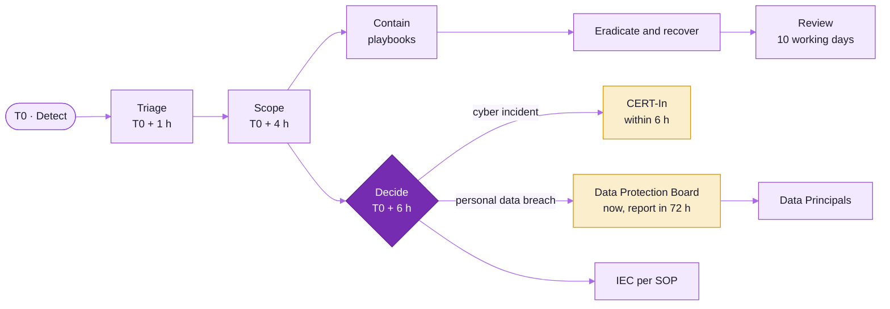

# Incident response runbook

**Version:** 0.1 DRAFT, 2026-10-21. **Owner:** Security lead. **Approvers:** DPO and legal counsel.
**Plan features:** PRV-10 (incident response, DPDP), PRV-09 (threat model).

> **[LEGAL REVIEW]** Notification deadlines below follow the DPDP Act 2023 section 8(6), the DPDP Rules 2025
> and the CERT-In Directions of 28 April 2022 as understood when this draft was written. Counsel must confirm
> each deadline, the required content and the commencement dates before the runbook is approved.

## 1. What counts as an incident

- **Personal data breach:** any unauthorised processing of personal data, or accidental disclosure,
  acquisition, sharing, use, alteration, destruction or loss of access, that compromises its confidentiality,
  integrity or availability (DPDP Act section 2(u)).
- **Security incident** without confirmed personal data impact (for example malware on a kiosk, a revoked
  certificate in use, a failed intrusion).
- **Research integrity or ethics incident:** a participant shown a report when the gate was closed, a wrong
  consent audio version played, a minor's data found, audio found in storage, a consent defect.

When in doubt, treat it as an incident and open a ticket.

## 2. Roles

| Role | Who | Responsibilities |
|---|---|---|
| Incident Commander (IC) | Security lead, or the on-call engineer until the Security lead takes over | Runs the response, keeps the timeline, decides containment |
| DPO | [TBD] | Decides whether it is a personal data breach, owns notifications to the Board and to Data Principals |
| Legal counsel | [TBD] | Advises on notifications and liability |
| Ethics Officer | [TBD] | Informs the IEC; handles participant welfare issues |
| PI | [TBD] | Research impact; communication with sponsor and sites |
| Communications | [TBD] | Prepares participant and public messages in the pilot languages |
| Scribe | Any team member | Records actions and times in the incident log |

On-call contacts: [TBD: phone tree]. The IC may call anyone at any hour for a severity 1 incident.

## 3. Severity

| Severity | Definition | Examples | Response |
|---|---|---|---|
| S1 | Confirmed or likely exposure of identity-vault data, or of linked data for many participants; ongoing attack | Vault read by an unknown principal; database dump exfiltrated | Immediate; all roles |
| S2 | Limited exposure of pseudonymous data, or loss of a device that may hold unsynced data | Stolen kiosk; mis-sent export; lost administrator tablet | Within 1 hour |
| S3 | No personal data exposure, but a control failed | Revoked certificate still accepted; retention run failing | Within 1 working day |
| S4 | Ethics or research-integrity incident without data exposure | Report shown while gate closed; wrong consent version played | Within 1 working day; Ethics Officer leads |

## 4. Response phases and timeline

Times are from the moment the team becomes aware of the incident (T0).

| Step | Deadline | Action |
|---|---|---|
| 1. Detect | T0 | Sources: alarms (anomalous exports, authentication bursts, tamper, certificate misuse, vault reads), staff or participant reports, processor notices, site reports |
| 2. Triage | T0 + 1 h | Open an incident record; appoint the IC; assign severity; start the timeline |
| 3. Scope | T0 + 4 h | Run the scope queries (section 6): affected kiosks, sessions, `pid`s, data classes, time window. Drill target: affected `pid`s scoped within 4 hours |
| 4. Contain | As soon as possible | Section 5 playbooks: revoke, wipe, rotate, suspend, disable exports, block network paths |
| 5. Decide | T0 + 6 h | DPO decides whether it is a personal data breach. Security lead decides whether it is a reportable cyber incident for CERT-In |
| 6. CERT-In | T0 + 6 h | Report reportable cyber incidents to CERT-In within 6 hours of noticing them |
| 7. Board | Without delay; detailed report within 72 h | Intimate the Data Protection Board of India of a personal data breach without delay, then a detailed report within 72 hours (nature, extent, timing, location, likely impact, mitigation, findings about the cause, measures to prevent recurrence, notifications to Data Principals) |
| 8. Data Principals | Without delay | Inform each affected Data Principal (section 7) |
| 9. IEC | Per the IEC SOP | Ethics Officer reports the incident as an unanticipated problem **[IEC REVIEW: confirm timeline]** |
| 10. Eradicate and recover | When contained | Remove the cause; restore from clean backups; re-apply tombstones after any restore; verify |
| 11. Post-incident review | Within 10 working days of closure | Root cause, what worked, what failed, actions with owners; update the DPIA and threat model |

Every step is recorded in the incident log with time, person and evidence.

## 5. Playbooks

### 5.1 Stolen or tampered kiosk

1. FleetOperator marks the kiosk compromised; **revoke its device certificate** (takes effect within 5
   minutes) so it can no longer upload or receive.
2. Issue a **remote wipe** command (applies if the device reconnects).
3. Determine unsynced sessions from the last heartbeat and outbox counters. Data on the disk is encrypted per
   session with keys sealed in the TPM; a pulled disk yields no readable data (PRV-07 acceptance criterion).
4. If the TPM is believed intact and the device not powered with an attacker's software, the DPO may
   decide this is not a breach; record the reasoning.
5. Re-provision a replacement with a new identity.

### 5.2 Lost administrator tablet

As 5.1, plus: suspend the administrator's sessions and tokens, and check the audit trail for activity after
the loss time.

### 5.3 Mis-sent or over-broad export

1. Ask the recipient to delete the file and confirm in writing.
2. Check whether the export was de-identified, had k-anonymity >= 5, and contained only archive-consent
   participants. If not, treat as a breach for the participants included.
3. Review why the justification and approval steps did not stop it.

### 5.4 Unexpected identity-vault read or compromised staff account

1. Disable the account; revoke tokens; force MFA reset.
2. Pull the audit trail for the account for the last 90 days.
3. If vault data was read without a justified IdentitySteward request, treat as S1.

### 5.5 Server or database compromise, ransomware

1. Isolate affected hosts; preserve forensic images.
2. Rotate database credentials, KMS grants, signing keys (release packs and erasure receipts) and the HMAC
   pepper if exposure is possible.
3. Restore from backups (14-day window), then **re-apply all erasure tombstones** before reopening.
4. Re-verify release-pack signatures; kiosks refuse unsigned or expired packs.

### 5.6 Report shown when it should not have been

1. Revoke the release pack (kiosks fall back to thank-you only).
2. Identify the sessions and report artefacts affected; delete the artefacts.
3. Ethics Officer decides whether and how to contact the participants (they may have been shown bands that
   were not validated).

### 5.7 Consent defect (wrong or unapproved audio version, missing tap record)

1. Stop data collection at the affected kiosks (policy update or pack rollback).
2. Park the affected sessions; data collected without a valid consent record is deleted unless the IEC
   approves a remedy.

### 5.8 Data from a minor discovered, or audio found in storage

Delete immediately under the erasure workflow, record the incident, find how the control failed, and inform
the Ethics Officer and the DPO.

## 6. Scope queries

The platform must provide these as saved, tested queries (tabletop drill target: under 4 hours end to end):

- sessions and `pid`s by kiosk id and time window (order by `session_id, seq`, never by kiosk wall time);
- sessions and `pid`s whose data was included in a given export or snapshot (export register,
  `snapshot_members`);
- vault records read in a time window (audit trail);
- data classes present for a list of `pid`s.

## 7. Notifying Data Principals

Many participants cannot read, so the primary channel is a **pre-recorded IVR call in the participant's
language**, using the number in the vault (only for those who gave it). SMS is a supplement. For participants
without contact details, a notice is placed at the sites and on the study web page, and staff at supervised
sites tell returning participants.

**Template (to be translated through the ITC workflow and recorded):**

> Hello. This is [study name], the game study you took part in at [site]. We are calling because on [date]
> something went wrong with how we protect study information. [One sentence, in plain words, on what
> happened.] The information involved was [what kind; for example "the answers you gave in the game", or
> "your phone number"]. It did not include your name. We have [what we did]. You do not need to do anything.
> If you want your information deleted, or have a question or complaint, call [helpline] or ask at [site].
> You can also complain to the Data Protection Board of India. Thank you.

The written notice to the Board and the participant message are reviewed by the DPO and legal counsel
before sending. **[LEGAL REVIEW]**

## 8. Drills

| Drill | Frequency | Pass criterion |
|---|---|---|
| Tabletop: database breach | Every 6 months | Affected `pid`s scoped within 4 hours; draft Board notice ready within 72 hours |
| Stolen-kiosk drill | Before Stage 2, then yearly | Certificate revoked and rejected within 5 minutes; disk yields no readable data |
| Backup restore with tombstone replay | Before Stage 2, then yearly | Zero readable rows for erased `pid`s after restore |

## 9. Records

The incident log, notifications sent, the Board report and the post-incident review are kept for the life
of the programme plus 3 years and are summarised (counts by severity) in the IEC evidence pack.
