# Retention and deletion policy

**Version:** 0.1 DRAFT, 2026-10-21. **Owner:** DPO. **Approvers:** DPO and legal counsel (two-person approval, PLT-09).
**Plan features:** PRV-05 (retention schedule engine), PRV-06a (minimal erasure), PRV-06 (full erasure with crypto-shredding).
**Must be in force before Stage 1.**

## 1. Principles

1. Personal data is kept only as long as its purpose needs it (DPDP Act section 8(7)), then deleted.
2. Every data class has one rule. The rule is enforced by the retention engine, not by hand.
3. Withdrawal of consent triggers erasure of the data collected under that consent, across every layer:
   raw, derived, snapshots, exports and backups.
4. Deletion fails safe: if the engine cannot confirm a purge, it reports the failure; it never marks data as
   deleted that was not deleted.
5. A legal hold suspends deletion only for the held scope, only with a written justification, and is
   reviewed every 90 days.

## 2. Retention schedule

"Engine rule" is the rule id in `backend/api/src/shriii_api/config/retention.yaml`. Rows marked **gap** have no
engine rule yet and must be added before the stage named in the last column.

| Data class | Retention | Trigger for deletion | Mechanism | Engine rule | Needed by |
|---|---|---|---|---|---|
| Scorable events parked without core consent | 72 hours (`consent_parking_ttl_hours`) | Parking time-out | Moved to dead letters as `no_consent`, then purged | `consent_parking_expired` | Stage 1 |
| Raw events, play-only sessions (not linked to a participant, no archive consent) | 90 days | Server receive date | Delete rows and objects; shred session DEK | `play_only_raw_events` | Stage 1 |
| Raw events, linked study sessions (criterion cohort, retest, substudies) | Study close-out plus **3 years** (proposed) | Study close-out date recorded in `study.studies` | Delete; shred DEKs | **gap** | Stage 2 |
| Dead-letter entries | 90 days after triage | Triage date | Delete | `dead_letters` | Stage 1 |
| Derived data (indicators, model estimates, style indices, quality flags) | Same as the raw events they came from | Source deletion | Cascade delete by `session_id` | **gap** (cascade) | Stage 2 |
| Criterion answers, scale scores, linkage rows | Study close-out plus 3 years (proposed) | Study close-out | Delete | **gap** | Stage 2 |
| Consent artefacts | Life of the data collected under them plus 3 years (proof of consent) | Last dependent data deleted | Delete, keep an anonymous count | **gap** | Stage 2 |
| Identity vault: contact details | Until the retest study ends, or earlier on withdrawal or opt-out; never beyond study end | `purge_after` (study end) | Delete vault row and its HMAC link | `vault_contacts` | Stage 3 |
| Participant report artefacts | Token expiry plus 30 days | Expiry | Delete | `expired_reports` | Report release |
| Research audio (think-aloud) | Deleted within 30 days after coding is complete | Coding-complete date (or capture plus 60 days, whichever comes first) | Delete encrypted file and key | **gap** | Stage 1 |
| ASR evaluation clips | Deleted within 30 days of the signed bake-off report, and no later than 6 months after capture | Report signed date / capture date | Delete encrypted files and key | **gap** | Stage 1 (ASR bake-off) |
| Kiosk local cache (outbox) | Until upload is confirmed; offline capacity 30 days, operations alert at 7 days | Server acknowledgement | Local delete and DEK shred | Kiosk outbox | Stage 1 |
| Analysis snapshots (de-identified) | While frozen for a registered analysis, then study close-out plus 3 years | Close-out, or rebuild after an erasure | Tombstone and rebuild | **gap** | Stage 2 |
| De-identified research archive (archive consent only) | 10 years (proposed) | Archive deposit date | Delete; notify recipients under data-use agreements | **gap** | Stage 2 |
| Decline counter | Indefinite (anonymous aggregate) | None | n/a | n/a | n/a |
| Telemetry (device health, timing) | 90 days | Event date | Delete | `telemetry` | Stage 1 |
| Security logs and staff audit trail | 1 year online, after daily export to versioned storage | Event date | Delete | `security_logs` | Stage 1 |
| Finished jobs | 30 days | Finish date | Delete | `finished_jobs` | Stage 1 |
| Database backups | 14 days or less | Backup date | Backup expiry | Infrastructure | Stage 1 |
| `session_keys` backups | 14 days or less | Backup date | Backup expiry (separate keys) | Infrastructure | Stage 1 |
| Governance records (signed approvals, sign-offs) | Life of the programme plus 10 years (contain staff names only) | Programme end | Archive | n/a | n/a |
| Data entered by someone who chose an under-18 band | Not stored at all | n/a | Session ends before anything persists | Kiosk | Stage 1 |

> **[STAKEHOLDER REVIEW] [LEGAL REVIEW]** The "3 years after study close-out" period for linked research data
> and the 10-year archive period are proposals. They must balance reproducibility (plan 7.10) and funder or
> journal requirements against minimisation. ICMR guidelines (2017) expect research records to be kept for a
> defined period after completion; counsel and the IEC must confirm the period for each class.

## 3. Retention engine operation

- A nightly **RetentionRun** applies every enabled rule and writes a report: rule id, rows or objects
  examined, deleted, held, failed. Failures raise an operations alert.
- **Legal holds** (`governance.legal_holds`) can be placed on a study, a session or a participant by the DPO,
  with a reason and a review date. A hold blocks deletion for that scope only. Holds are listed in every
  RetentionRun report.
- **Acceptance tests** (PRV-05): back-dated synthetic records and their derived data are purged; a hold
  blocks the purge.
- Rule changes follow change control (two-person approval) and are reflected in this table in the same
  change.

## 4. Erasure workflow

### 4.1 Triggers

| Trigger | Channel | Scope |
|---|---|---|
| In-session "delete" (hand icon) | Kiosk | The current session |
| Withdrawal after the session | Helpline, administrator, retest token or QR card | All data for the `pid`, or for the session token |
| Withdrawal of one optional consent (archive, contact) | Helpline or administrator | Data held only for that purpose (for example the vault record, or archive copies) |
| Contact opt-out during a reminder call | IVR keypress or call handler | Vault record |
| Retention expiry | Retention engine | Per rule |

### 4.2 Identity check

The requester proves the link with what they already hold: the retest token, the QR card or `pid` card, or,
for in-session deletion, presence at the kiosk. Where none is available, the administrator may match on
site, date, time window and picture-band answers; a match that is not unique is refused, because deleting
another person's data would itself be a harm. No identity documents are collected.

### 4.3 Steps

```mermaid
%%{init: {"theme":"base","themeVariables":{"fontFamily":"Inter, ui-sans-serif, system-ui, -apple-system, Segoe UI, Roboto, Helvetica, Arial, sans-serif","fontSize":"15px","primaryColor":"#F2E9FE","primaryTextColor":"#1E1B2E","primaryBorderColor":"#9148D2","secondaryColor":"#FAEECD","secondaryTextColor":"#1E1B2E","secondaryBorderColor":"#CD9200","tertiaryColor":"#F3F1FA","tertiaryTextColor":"#1E1B2E","tertiaryBorderColor":"#A7A3BC","mainBkg":"#F2E9FE","nodeBorder":"#9148D2","nodeTextColor":"#1E1B2E","lineColor":"#AA69E9","textColor":"#857F9E","edgeLabelBackground":"#F9F5FF","clusterBkg":"#F9F5FF","clusterBorder":"#D6B6FB","titleColor":"#762CB1","noteBkgColor":"#FAEECD","noteTextColor":"#1E1B2E","noteBorderColor":"#CD9200","actorBkg":"#F2E9FE","actorBorder":"#9148D2","actorTextColor":"#1E1B2E","actorLineColor":"#AA69E9","signalColor":"#AA69E9","signalTextColor":"#857F9E","labelBoxBkgColor":"#F2E9FE","labelBoxBorderColor":"#9148D2","labelTextColor":"#1E1B2E","loopTextColor":"#857F9E","activationBkgColor":"#E7D5FE","activationBorderColor":"#9148D2","sequenceNumberColor":"#FFFFFF","transitionColor":"#AA69E9","transitionLabelColor":"#857F9E","stateLabelColor":"#1E1B2E","stateBkg":"#F2E9FE","compositeBackground":"#F9F5FF","compositeTitleBackground":"#F2E9FE","attributeBackgroundColorOdd":"#FFFFFF","attributeBackgroundColorEven":"#F9F5FF","relationColor":"#AA69E9","relationLabelBackground":"#F9F5FF","relationLabelColor":"#1E1B2E"}}}%%
flowchart LR
  REQ["1 · Request recorded<br/>sync stopped"] --> KI["2 · Kiosk purge<br/>DEK destroyed"]
  KI --> PS["3 to 5 · Primary stores,<br/>vault, audio"]
  PS --> SW{"6 · Sweep query<br/>zero rows in 72 h"}
  SW --> CS["7 · Crypto-shred<br/>wrapped DEK"]
  CS --> SN["8 · Snapshot tombstone<br/>and rebuild"]
  SN --> EX["9 · Export recipients<br/>notified"]
  EX --> BK["10 · Backups expire<br/>within 14 days"]
  BK --> RC["11 · Signed receipt"]
  classDef accent fill:#762CB1,stroke:#5F1C93,color:#FFFFFF
  class SW accent
```

Steps 1 to 6 are PRV-06a (required before Stage 1); steps 7 to 11 complete PRV-06 (required before Stage 2
for anything beyond primary stores).

1. **Record** an `ErasureRequest` (who asked, channel, scope, time). Stop all sync for the session or `pid`.
2. **Kiosk:** purge local rows and destroy the session DEK within 1 second; queue a tombstone keyed by
   `session_id` that covers events already uploaded and events not yet uploaded.
3. **Primary stores, by `session_id` and `pid`:** `kiosk_raw.events`, `consent_parking`, `dead_letter`;
   `scored.*` (trials, indicators, model estimates, style indices, session quality); `criterion.responses`
   and `criterion.scale_scores`; `linkage.participant_links` and pairing codes; report artefacts; co-play
   rows for that player slot (the partner's own data is kept).
4. **Identity vault:** delete the contact record and its HMAC link.
5. **Research audio and ASR clips:** delete files and their keys.
6. **Sweep query** confirms zero rows for the `pid`/session in primary stores; the deadline is **72 hours**
   from the request.
7. **Crypto-shredding:** delete the wrapped session DEK, so encrypted raw objects and all object versions
   become unreadable.
8. **Snapshots:** look up `validation.snapshot_members`; tombstone each affected snapshot and run an
   explicit rebuild that produces a superseding snapshot without the person. Analysis runs that used the old
   snapshot are marked "reproducible modulo erasures"; published aggregates are not recalled (the consent
   script says this).
9. **Exports:** check the export recipient register; notify each recipient of a de-identified export that
   contained the person, under the data-use agreement.
10. **Backups:** expire within 14 days. After any restore, the replay guard re-applies all tombstones before
    the restored database is used (drill: zero readable rows for the `pid` after restore).
11. **Receipt:** issue a signed erasure receipt (Ed25519) with the request id, scope, time, and the stores
    cleared. Keep only the receipt and a minimal tombstone (hashed identifiers to block re-ingestion).

### 4.4 What erasure does not remove

- Anonymous counts (the decline counter, completion counts) and aggregate results already published.
- The erasure receipt and tombstone (needed to prove the erasure and to prevent the data from returning).
- Staff audit-log entries that record that an erasure happened (they hold no participant data beyond the
  hashed identifier).

### 4.5 Monitoring

Monthly erasure statistics (requests, completed within 72 hours, failures, average time) go to the DPO and
into the IEC evidence pack.
