<picture>
  <source media="(prefers-color-scheme: dark)" srcset="assets/hero-dark.svg">
  
</picture>

# README style guide

The one visual system for every IIT repository README. Every asset here is self-contained: hand-built
SVG in our product tokens, animated with CSS and SMIL only, light and dark variants, checked in CI.

The bar is the product's own: **premium, concise, calm**. One idea per section, one sentence where a
paragraph would do, motion that explains or delights and never distracts.

<picture>
  <source media="(prefers-color-scheme: dark)" srcset="assets/divider-dark.svg">
  
</picture>

## Contents

| | |
|---|---|
| [1. The kit](#1-the-kit) | what is in this folder |
| [2. Anatomy of a README](#2-anatomy-of-a-readme) | the section order every README follows |
| [3. Tokens](#3-tokens) | colour, type, radius |
| [4. Templates](#4-templates) | hero, cards, pipeline, stats, timeline, divider, footer, icons |
| [5. Light and dark](#5-light-and-dark) | the `<picture>` pattern |
| [6. Mermaid](#6-mermaid) | every diagram, themed to the palette |
| [7. Tables](#7-tables) | matrices and specs |
| [8. Motion](#8-motion) | what moves, how, and reduced motion |
| [9. GIFs](#9-gifs) | the narrow case, rendered in CI |
| [10. What GitHub allows](#10-what-github-allows) | the camo constraints |
| [11. Copying the kit](#11-copying-the-kit-to-another-repo) | adopting it in another repo |
| [12. CI](#12-ci) | `readme-check.yml` |
| [13. How this is kept true](#13-how-this-is-kept-true) | |

## 1. The kit

| Path | What it is |
|---|---|
| `README_STYLE.md` | this guide |
| `kit.json` | the repo's content: every word that appears in an SVG |
| `assets/*-light.svg`, `assets/*-dark.svg` | generated templates, one pair per `kit.json` key |
| `assets/icons/*.svg` | 48 px heading icons, one file that works on both themes |
| `tools/build.mjs` | generates `assets/` from `kit.json` |
| `tools/icons.mjs` | icon geometry (Lucide, ISC licence, see `LICENSE-lucide.txt`) |
| `tools/check.mjs` | the rules CI enforces: SVG safety, references, mermaid extraction, rendered-HTML checks |
| `tools/preview.mjs` | renders every asset and diagram to PNG in CI, light, dark and reduced motion |
| `tools/github.mjs` | opens every Markdown file with a mermaid block on github.com in CI and fails on any block GitHub cannot draw |

Never hand-edit `assets/`. Change `kit.json` or `tools/build.mjs`, then regenerate:

```sh
node docs/readme-kit/tools/build.mjs
```

CI regenerates too, and fails if the committed files differ.

## 2. Anatomy of a README

Every README follows this order. Skip a section rather than pad it.

| # | Section | Built from |
|---|---|---|
| 1 | Hero | `hero` template in `<picture>` |
| 2 | Typing line | readme-typing-svg, two colourways in `<picture>` |
| 3 | Badges | shields.io, `for-the-badge`, ink background, purple label |
| 4 | Pitch | one paragraph, at most four sentences |
| 5 | At a glance | `stats` template |
| 6 | What it does | `cards` template, then a short table of links |
| 7 | How it works | `pipeline` template, then one mermaid architecture flowchart |
| 8 | Built with | skillicons.dev row in `<picture>` |
| 9 | Quick start | numbered steps and fenced commands |
| 10 | Documentation | table: question on the left, link on the right |
| 11 | Status | `timeline` template |
| 12 | Footer | `footer` template |

Separate major sections with the `divider` template. Section headings carry an icon:

```html
## &nbsp; How it works
```

### Typing line

```html
<p align="center">
  <picture>
    <source media="(prefers-color-scheme: dark)" srcset="https://readme-typing-svg.demolab.com?font=Plus+Jakarta+Sans&weight=600&size=20&duration=2800&pause=900&color=C090F5&center=true&vCenter=true&width=760&lines=First+line;Second+line">
    
  </picture>
</p>
```

At most five lines, each under 60 characters. The `alt` carries every line.

### Badges

```html
<p align="center">
  
  
</p>
```

Label `762CB1`, value `1E1B2E`. One row, at most six. Status badges (CI, release) use the workflow's own
badge URL and sit last.

### Built with

```html
<p align="center">
  <picture>
    <source media="(prefers-color-scheme: dark)" srcset="https://skillicons.dev/icons?i=nextjs,react,ts,tailwind,py,fastapi,postgres,prisma,kotlin,androidstudio,aws,terraform,docker,githubactions,vercel&theme=dark&perline=15">
    
  </picture>
</p>
```

One row. Only what the repo really runs.

## 3. Tokens

Source of truth: `frontend/tailwind.config.ts` and `frontend/app/globals.css`. The SVGs carry the hex
equivalents because GitHub's sanitiser and older renderers do not all read `oklch()`.

| Role | Light | Dark | Source |
|---|---|---|---|
| Accent | `#762CB1` | `#C090F5` | purple-700 `oklch(0.47 0.198 305)` / purple-400 |
| Accent text | `#762CB1` | `#D6B6FB` | purple-700 / purple-300 |
| Accent soft fill | `#F9F5FF` | `#2F0D4B` | purple-50 / purple-950 |
| Accent hairline | `#E7D5FE` | `#5F1C93` | purple-200 / purple-800 |
| Secondary accent | `#CD9200` | `#E0AF43` | gold-500 / gold-400 |
| Page | `#F7F6FB` | `#110F19` | `--bg-0` |
| Card | `#FFFFFF` | `#1A1725` | `--card` |
| Surface 50 / 100 / 200 / 300 | `#FAF9FD` `#F3F1FA` `#E9E6F5` `#DCD7EE` | `#201C2D` `#262135` `#2E2840` `#3A3350` | `--surface-*` |
| Line | `#E4E2EF` | `#342E47` | `--line-200` |
| Ink 900 / 700 / 500 / 300 | `#1E1B2E` `#3A3651` `#615D7A` `#A7A3BC` | `#F2F0F9` `#D0CBDF` `#9E98B2` `#6E6884` | `--ink-*` |

Type, with system fallbacks because an SVG inside `` cannot load a web font:

| Use | Family | Weight |
|---|---|---|
| Display: titles, numbers, card heads | Plus Jakarta Sans, Inter, system-ui, Segoe UI, Roboto, Helvetica, Arial | 700 to 800, tracking -0.3 to -1.5 |
| Body | Inter, system-ui, Segoe UI, Roboto, Helvetica, Arial | 400 to 600 |
| Eyebrows, dates, captions | JetBrains Mono, ui-monospace, SF Mono, Menlo, Consolas | 600, uppercase, tracking 1.2 to 1.6 |

Radii: cards 18, hero and footer 22 to 24, chips fully rounded. Text in SVGs wears ink tokens; the
accent marks identity, it is never the only carrier of meaning.

## 4. Templates

All templates are 1200 px wide and scale to the column with `width="100%"`.

<picture>
  <source media="(prefers-color-scheme: dark)" srcset="assets/stats-dark.svg">
  
</picture>

<picture>
  <source media="(prefers-color-scheme: dark)" srcset="assets/cards-dark.svg">
  
</picture>

<picture>
  <source media="(prefers-color-scheme: dark)" srcset="assets/pipeline-dark.svg">
  
</picture>

<picture>
  <source media="(prefers-color-scheme: dark)" srcset="assets/timeline-dark.svg">
  
</picture>

| Template | Height | `kit.json` keys | Motion | Limits |
|---|---|---|---|---|
| `hero` | 420 | `eyebrow`, `name`, `titleWrap`, `tagline`, `chips[]`, `motifCaption`, `label` | gradient name sweep (SMIL), drifting mesh, swaying warp, weft woven row by row with a travelling shuttle (SMIL), swaying waves, staggered rise | name 2 lines, tagline 3 lines, 5 chips |
| `cards` | 214 per row | `label`, `columns`, `cardHeight`, `items[]` of `icon`, `tag`, `title`, `body` | staggered rise, glint across each card's top edge | body 3 lines; 3 columns, or 2 for wide copy |
| `pipeline` | 262 | `label`, `hop`, `stages[]` of `icon`, `title`, `sub` | progress fill, flowing dashes, a glowing pulse (SMIL) that lights each node as it arrives | 3 to 6 stages, sub 2 lines |
| `stats` | 170 | `label`, `tiles[]` of `icon`, `kicker`, `value`, `unit`, `label` | staggered rise, accent rule draws in | 2 to 4 tiles |
| `timeline` | 244 | `label`, `items[]` of `date`, `title`, `sub`, `now` | progress draws to `now`, halo pulse on `now` | 3 to 7 items |
| `divider` | 40 | `label` | glint sweep, slow diamond spin | |
| `footer` | 210 | `title`, `sub`, `label` | gradient sweep (SMIL), swaying waves, rising sparks | title one line |
| `icons` | 48 | `"all"` or a list of names | none | one file for both themes |

`label` becomes both `<title>` and `aria-label`; write it as the sentence a screen reader should say.

A template can be used more than once. A key with a variant after a colon builds a second pair: `"cards:ai"`
writes `assets/cards-ai-light.svg` and `assets/cards-ai-dark.svg`, `"pipeline:transcript"` writes
`assets/pipeline-transcript-*.svg`. Variant names are lower-case words joined by hyphens. `build.mjs` deletes
every generated pair before it writes, so a key removed from `kit.json` removes its files too.

Stats are for design facts that do not drift (tiers, platforms, formats). A count that changes with the
code (models, endpoints, tests) belongs in `docs/REPO_FACTS.md`, never in an image.

Icons available: activity, archive, award, badge-check, book, book-open, bot, box, brain, building-2,
camera, chart-column, chart-line, circuit-board, cloud, code, compass, container, cpu, database,
file-text, flask-conical, gauge, git-branch, globe, hard-drive, landmark, languages, layers, lock, mail,
map, mic, microchip, network, notebook-pen, palette, pen-tool, radio-tower, rocket, scroll-text, search,
send, server, shield-check, smartphone, sparkles, terminal, users, wifi-off, workflow, wrench, zap. To
add one, paste its Lucide 24 px geometry into `tools/icons.mjs`.

## 5. Light and dark

Every themed asset ships as a pair and is placed with `<picture>`. The `` is the light fallback
and always has `alt`:

```html
<picture>
  <source media="(prefers-color-scheme: dark)" srcset="docs/readme-kit/assets/hero-dark.svg">
  
</picture>
```

Paths are relative to the Markdown file. Decorative pieces (dividers) take `alt=""`.

## 6. Mermaid

Every architecture, sequence, state, ER and flow diagram is mermaid, in a fenced `mermaid` block, and
starts with this directive. Mermaid on GitHub draws one image for both themes, so the palette uses
light node fills with ink text (legible on white and on GitHub dark) and mid-tone purple lines and
free-standing text (legible on both backgrounds).

```text
%%{init: {"theme":"base","fontFamily":"Inter, ui-sans-serif, system-ui, -apple-system, Segoe UI, Roboto, Helvetica, Arial, sans-serif","themeVariables":{"fontSize":"15px","primaryColor":"#F2E9FE","primaryTextColor":"#1E1B2E","primaryBorderColor":"#9148D2","secondaryColor":"#FAEECD","secondaryTextColor":"#1E1B2E","secondaryBorderColor":"#CD9200","tertiaryColor":"#F3F1FA","tertiaryTextColor":"#1E1B2E","tertiaryBorderColor":"#A7A3BC","mainBkg":"#F2E9FE","nodeBorder":"#9148D2","nodeTextColor":"#1E1B2E","lineColor":"#AA69E9","textColor":"#857F9E","edgeLabelBackground":"#F9F5FF","clusterBkg":"#F9F5FF","clusterBorder":"#D6B6FB","titleColor":"#762CB1","noteBkgColor":"#FAEECD","noteTextColor":"#1E1B2E","noteBorderColor":"#CD9200","actorBkg":"#F2E9FE","actorBorder":"#9148D2","actorTextColor":"#1E1B2E","actorLineColor":"#AA69E9","signalColor":"#AA69E9","signalTextColor":"#857F9E","labelBoxBkgColor":"#F2E9FE","labelBoxBorderColor":"#9148D2","labelTextColor":"#1E1B2E","loopTextColor":"#857F9E","activationBkgColor":"#E7D5FE","activationBorderColor":"#9148D2","sequenceNumberColor":"#FFFFFF","transitionColor":"#AA69E9","transitionLabelColor":"#857F9E","stateLabelColor":"#1E1B2E","stateBkg":"#F2E9FE","compositeBackground":"#F9F5FF","compositeTitleBackground":"#F2E9FE","attributeBackgroundColorOdd":"#FFFFFF","attributeBackgroundColorEven":"#F9F5FF","relationColor":"#AA69E9","relationLabelBackground":"#F9F5FF","relationLabelColor":"#1E1B2E"}}}%%
```

Rules:

- Node text is a noun phrase, at most two short lines; put detail in the prose, not the box.
- Use `classDef accent fill:#762CB1,stroke:#5F1C93,color:#FFFFFF` for the one node the reader should
  find first, and `classDef gold fill:#FAEECD,stroke:#CD9200,color:#1E1B2E` for external systems.
- Group with `subgraph`; at most three levels.
- Flowcharts read left to right (`LR`) when they have stages, top down (`TD`) when they have layers.
- No HTML entities such as `&lt;` or `&quot;`: GitHub decodes them before mermaid reads the block, so a
  quote ends the label and `<` starts a tag. Write mermaid's own codes, `#lt;`, `#gt;`, `#quot;`, `#amp;`.
- No `;` in a label outside a quoted string: it ends the statement and the rest becomes stray nodes.
- No `<b>` or other tags in sequence diagram messages and notes; GitHub prints them as text.
- A sequence note line is at most about 45 characters; break longer notes with `<br/>`. A note over two
  participants is as wide as the gap between them, so a longer line runs out of its box.
- The font stack is the top-level `"fontFamily"`, never `themeVariables.fontFamily`. Mermaid sizes every
  box for the top-level font; a themeVariables font never reaches the labels on github.com, which draws
  them in its own Helvetica stack, so on Windows and macOS, where Trebuchet MS (mermaid's default) is
  about a tenth narrower than Helvetica and Arial, every entity, node and edge label is clipped.

### Architecture

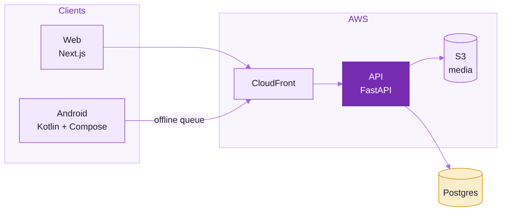

### Sequence

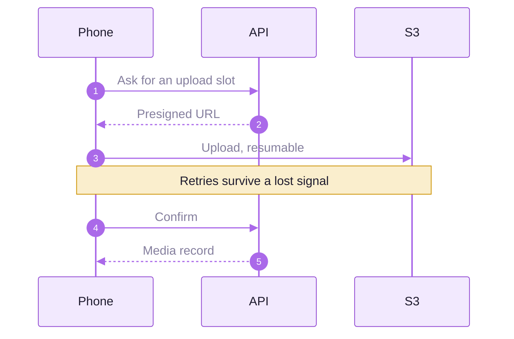

### State

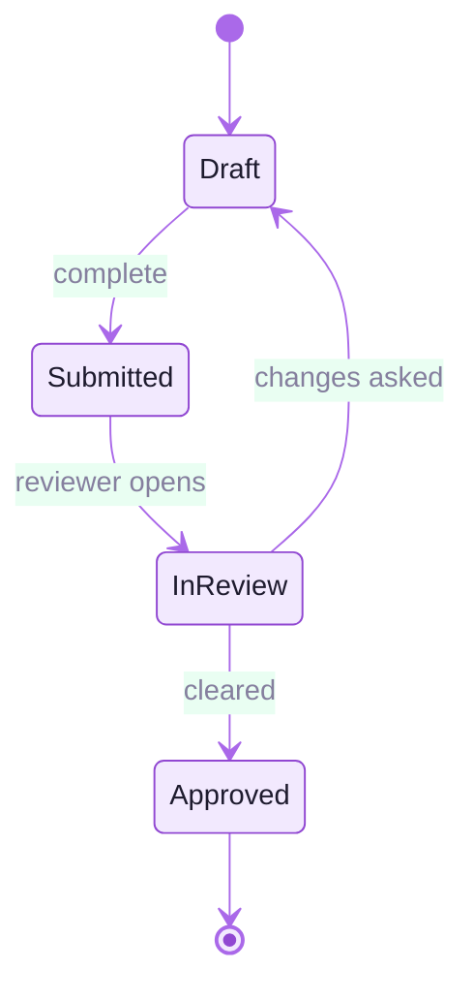

### Entity relationship

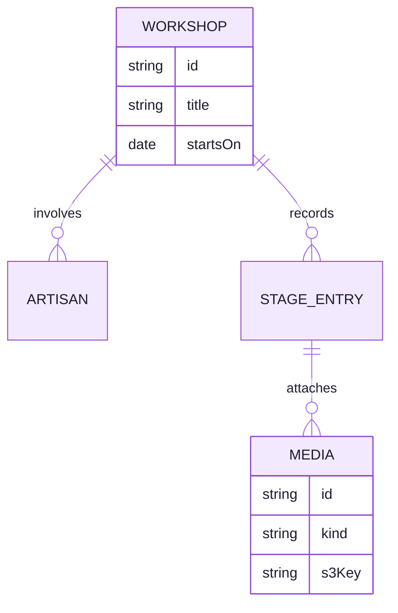

### Flow

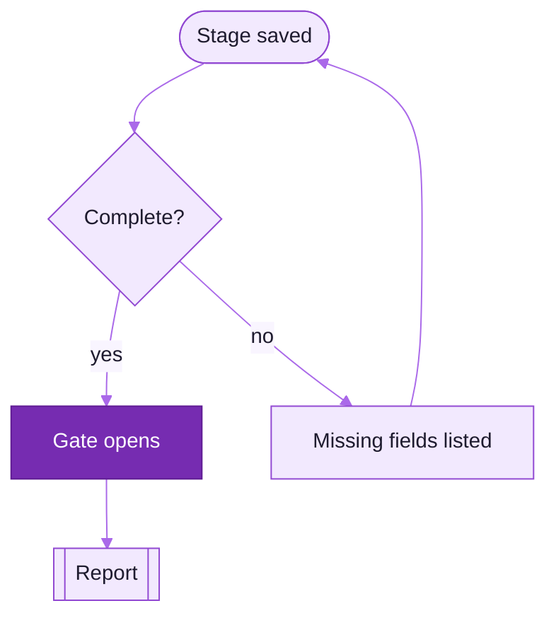

A diagram only needs the variables its type uses; the full directive above is always safe to paste.

## 7. Tables

Tables carry matrices and specs; prose carries reasons.

- A header row always; first column is the thing, later columns are its properties.
- Code, paths and identifiers in backticks; numbers right-aligned with `---:`.
- Use ✓ and · in capability matrices, never colour alone.
- A table wider than six columns becomes two tables.

| Capability | Web | Android |
|---|:---:|:---:|
| Capture every stage | ✓ | ✓ |
| Report offline | · | ✓ |

## 8. Motion

| Rule | Why |
|---|---|
| CSS keyframes for transform, opacity and stroke-dashoffset | GitHub's `` runs them, and reduced motion can switch them off |
| SMIL only for what CSS cannot animate: `gradientTransform` sweeps and `animateMotion` paths | |
| Every SMIL element sits in a `class="smil"` group, or its fill is `class="sweep"` | the reduced-motion rule hides the first and swaps the second to a still gradient |
| Every SVG ends its style with `@media (prefers-reduced-motion:reduce){*{animation:none!important}.smil{display:none}.sweep{fill:url(#still)}}` | the reduced state must be the finished state, so base styles hold the end values and keyframes animate *from* the start |
| Entrances run once in under 1.5 s; loops are 5 s or slower, ease-in-out | calm, never busy |
| Never animate an element through its `transform` attribute: wrap it in a `<g>` and animate the wrapper | a CSS transform replaces the attribute |
| No flashing, nothing faster than 3 changes a second | WCAG 2.3.1 |

## 9. GIFs

Only when motion explains something an SVG cannot, such as a real UI flow. A GIF is:

- rendered on GitHub Actions from real Playwright screenshots of the deployed app, never on a laptop;
- under 3 MB (CI fails above), 800 px wide, at most 12 seconds, looping;
- placed with `alt` that describes the flow step by step.

Recipe for the workflow that makes one: Playwright drives the flow and saves a screenshot per step,
`ffmpeg -framerate 2 -i step-%02d.png -vf "scale=800:-1:flags=lanczos,split[a][b];[a]palettegen=max_colors=96[p];[b][p]paletteuse=dither=bayer" flow.gif`
builds it, and the job uploads it as an artifact for review before it is committed.

## 10. What GitHub allows

GitHub serves README images through its camo proxy as ``. Inside that sandbox:

| Allowed | Not allowed |
|---|---|
| inline `<style>`, CSS keyframes, SMIL | `<script>`, event attributes |
| gradients, filters, patterns, clip paths by `#id` | `<foreignObject>`, `<image>`, any external `href` or `url()` |
| system font stacks | `@font-face`, `@import`, web fonts |
| `prefers-reduced-motion` media queries | `prefers-color-scheme` to switch the theme (it follows the OS, not GitHub); use `<picture>` |

Every SVG is under 60 KB and has `role="img"`, `aria-label` and a `<title>`.

## 11. Copying the kit to another repo

Each repository carries its own copy so its README assets are self-contained.

1. Copy `docs/readme-kit/` into the target repo at the same path, and `.github/workflows/readme-check.yml`
   beside its other workflows.
2. Rewrite `kit.json` for that repo: hero copy, cards, pipeline, stats, timeline, footer. Drop a key to
   skip that template.
3. Run `node docs/readme-kit/tools/build.mjs` and commit `assets/`.
4. Write the README to the [anatomy](#2-anatomy-of-a-readme), with `docs/readme-kit/assets/...` paths.
5. Push; `readme-check.yml` validates it and uploads a preview artifact.

`tools/`, `README_STYLE.md` and `LICENSE-lucide.txt` stay byte-identical across repos; only `kit.json`
and the generated `assets/` differ. Improve the kit in designer-portal first, then copy it on.

## 12. CI

`.github/workflows/readme-check.yml` runs on any change to `README.md`, a Markdown file under `docs/` or `.claude/skills/`, the kit or the workflow. It checks every one of those files, not only the README:

| Step | Fails when |
|---|---|
| Kit assets match `kit.json` | `assets/` differs from a fresh `build.mjs` run |
| SVG rules | over 60 KB; `<script>`, `<foreignObject>`, `<image>`, event attributes, external `href`/`url()`, `@import`, `@font-face`; no `<title>`, `aria-label` or `role="img"`; animated without a reduced-motion rule |
| xmllint | an SVG is not well-formed XML |
| Image references | a local image is missing, a GIF is over 3 MB, a raster is over 1 MB, a `<picture>` lacks the dark source or `alt` |
| Mermaid | any block in `README.md`, `docs/**` or `.claude/skills/**` fails to render in mermaid-cli, run on the mermaid release github.com ships and with GitHub's `securityLevel` and layout settings; a block without `%%{init}%%` is a warning (`--strict` makes it an error) |
| GitHub render | `gh api markdown` escapes an HTML tag, leaks a code fence, or drops a `<picture>` or mermaid block; a file over the API's 400 KB limit is skipped with a warning |
| github.com renders every mermaid block | the authoritative check. Playwright opens each tracked Markdown file with a mermaid block at the pushed commit on github.com and fails when a block's viewer shows an error, draws no SVG, draws NaN coordinates or prints raw markup, when a block is missing from the page, when a block uses an HTML entity or a statement-ending `;` in a label or a `themeVariables.fontFamily` without the same top-level `fontFamily`, or when any label's text (node, entity, attribute, edge, actor, note, message or cluster title) is more than 2 px wider or taller than its label box or, except for edge labels and messages, wider than the shape it sits in. On Linux it draws `"trebuchet ms"` and Verdana in a condensed face and Helvetica and Arial in Liberation Sans, so a box sized for one font and drawn in another overflows as it does on Windows and macOS |

The `readme-preview` artifact holds PNGs of every asset and diagram in light, dark and reduced motion, and
full-page screenshots of `README.md` and `docs/README.md` as GitHub renders them (`gh api markdown`), with
every mermaid block drawn in place and the `<picture>` sources chosen by the light or dark colour scheme.
The `github-mermaid` artifact holds a screenshot of every mermaid block as github.com draws it, a
full-page screenshot of each file, `report.tsv` with one line per block, and `clipped.tsv` with one line
per clipped label: block, kind, text, text width and box width.

## 13. How this is kept true

- Tokens: when `frontend/tailwind.config.ts` or `frontend/app/globals.css` changes a purple, gold, ink,
  surface or line value, update `THEMES` in `tools/build.mjs` and the table in section 3, regenerate,
  and copy the kit on.
- Templates: `assets/` is generated; CI fails if it drifts from `kit.json` and `build.mjs`.
- Rules: section 10 and section 12 describe `tools/check.mjs`; change them together.
- Re-read this guide when GitHub changes how it renders SVG, `<picture>` or mermaid.

<picture>
  <source media="(prefers-color-scheme: dark)" srcset="assets/footer-dark.svg">
  
</picture>
