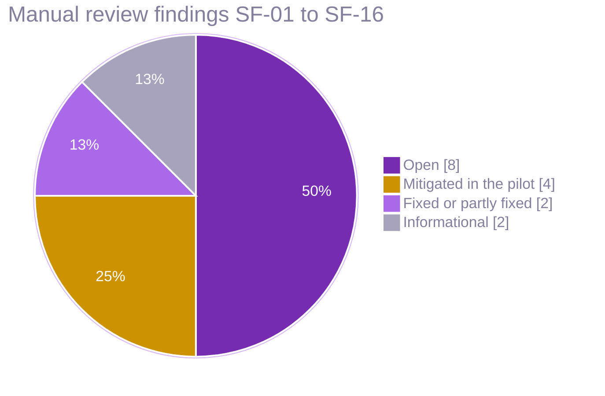

# Security and privacy engineering

Security documents for the SHRIII Kiosk Behavioural Games platform. They implement the documentation part of
**PRV-09** (security hardening and threat model) and support PRV-01 to PRV-13, KSK-09 to KSK-13 and QA-05 in
`docs/IMPLEMENTATION_PLAN.md`.

| Document | What it gives you |
|---|---|
| [threat-model.md](threat-model.md) | STRIDE analysis of the kiosk (physical access, tampering, onlookers, USB), transport, API, data platform, research web app and insiders; abuse cases from PRV-09; residual risks needing an owner |
| [data-flows.md](data-flows.md) | Mermaid data-flow diagrams with trust boundaries, the key hierarchy and the erasure flow |
| [controls-matrix.md](controls-matrix.md) | Every control mapped to plan features (PRV-*, KSK-*, ING-*, REP-*), threats, wave-1 status with code evidence, and verification |
| [scan-findings.md](scan-findings.md) | Results of pip-audit, pnpm audit and semgrep on the wave-1 code, semgrep triage, manual review findings SF-01 to SF-16, and where each finding stands now |
| [pentest-checklist.md](pentest-checklist.md) | Test cases per surface, with blockers for the Stage 2 gate (ASVS L2) |
| [kiosk-hardening-ubuntu-core.md](kiosk-hardening-ubuntu-core.md) | Ubuntu Core 24 image, FDE/TPM, snap confinement, USB and HID lockdown, network, OTA rings, provisioning and incident steps |
| [supply-chain-policy.md](supply-chain-policy.md) | Dependency intake rules, lockfiles, CI scanners, signing and provenance, repository controls, vulnerability SLAs |
| [`scans/`](scans/) | Raw JSON output of the automated scans |

Load and capacity findings that affect availability (threat A-05, finding SF-01) are in
[`tools/loadtest/RESULTS.md`](../../tools/loadtest/RESULTS.md), with proposed patches in
`tools/loadtest/proposals/`.

## Where things stand (2026-11-04)

The documents below were written against the wave-1 code (`1b01cae`, 2026-10-21). Since then a production pilot
went live on synthetic data (Vercel console, EC2 API behind Caddy, Supabase Postgres), and the CI security
pipeline started running. What moved:

| Area | Now | Detail |
|---|---|---|
| CI scanning | CodeQL on every PR, every push to `main` and weekly; OSV-Scanner 2.7 on every PR and daily over `uv.lock` and every document of `pnpm-lock.yaml`; Dependabot weekly with a 7-day soak; every action pinned by commit SHA | [supply-chain-policy.md](supply-chain-policy.md#9-current-state) |
| Edge | Caddy terminates TLS (Let's Encrypt), sends HSTS, CSP, `X-Frame-Options`, `nosniff`, `Referrer-Policy`, caps bodies at 2 MB (10 MB for criterion imports) | [../deploy/aws-ec2.md](../deploy/aws-ec2.md#edge-caddy) |
| Staff sign-in | Password accounts (scrypt, five-failure lockout for 15 minutes, 8-hour tokens, forced first change); no MFA yet | [../deploy/aws-ec2.md](../deploy/aws-ec2.md#api-settings) |
| Secrets | Every key in SSM Parameter Store (SecureString), rendered to a root-only file at deploy; none in the repo, images or user data | [../deploy/aws-ec2.md](../deploy/aws-ec2.md#ssm-parameters-shriiiprod-securestring) |
| Identity vault | A separate database (`shriii_identity`) with its own login in production; the code fallback (SF-04) is still there | [../deploy/supabase.md](../deploy/supabase.md#databases-and-roles) |
| Kiosk | Electron fuses and ASAR integrity set at packaging; remote commands Ed25519-signed with a key pinned into the build | [scan-findings.md](scan-findings.md#0-status-on-2026-11-04) |
| Repository | `main` has no branch protection rule; changes land through pull requests by convention | C-36 in [controls-matrix.md](controls-matrix.md#changes-since-wave-1-2026-11-04) |



## Top actions before Stage 2

1. **Ingestion capacity and admission control** (SF-01, SF-13): apply or re-implement the proposals in
   `tools/loadtest/proposals/`, run several API workers, add proxy size and rate limits; re-run
   `shriii-loadtest suite` until ING-02 passes.
2. **Report-token leakage** (SF-03) and **vault separation** (SF-04): small code changes, high privacy value.
3. **Recursive forbidden-field scrub** (SF-05): closes a PRV-03 gap in the tolerant reader.
4. **KMS-backed keys and key separation** (SF-07), **mTLS for kiosks** (C-07) and **batch signatures** (C-18).
5. **Finish the CI security pipeline** per [supply-chain-policy.md](supply-chain-policy.md) §4: CodeQL, OSV-Scanner
   and Dependabot run; semgrep, gitleaks, container scanning, SBOMs, signing and branch protection do not yet.
6. **Kiosk image** per [kiosk-hardening-ubuntu-core.md](kiosk-hardening-ubuntu-core.md), then the kiosk
   section of the pentest checklist.

## Re-running the scans

From the repository root (Windows or Linux, Python 3.13+, Node 24, pnpm 12):

```bash
# Python dependencies (wave-1 workspace, without the load-test tools)
uv export --frozen --no-hashes --no-emit-workspace --format requirements-txt -o /tmp/reqs.txt
uvx pip-audit -r /tmp/reqs.txt --no-deps --disable-pip --format json -o docs/security/scans/pip-audit-wave1.json

# JavaScript dependencies
pnpm audit --json > docs/security/scans/pnpm-audit.json

# SAST (semgrep runs natively on Windows since 1.1xx; or use the semgrep/semgrep Docker image)
uvx semgrep scan --metrics off \
  --config p/default --config p/owasp-top-ten --config p/secrets --config p/python \
  --config p/typescript --config p/jwt --config p/sql-injection --config p/dockerfile \
  --exclude node_modules --exclude .venv --exclude dist --exclude docs/reference \
  --json -o docs/security/scans/semgrep.json frontend backend contracts stats content tools/loadtest infra/compose/docker-compose.yml
```

Update [scan-findings.md](scan-findings.md) with any new finding and its triage.

## Keeping these documents current

Update the threat model and controls matrix when a change adds an endpoint or role, changes the event
envelope or `UploadBatch`, touches keys, consent or erasure, adds a kiosk peripheral or OS interface, adds an
export path or a third-party service (see threat-model.md §11). Each control's status should move from
Planned to Implemented only with a test or measurement named in its "Verification" column.
